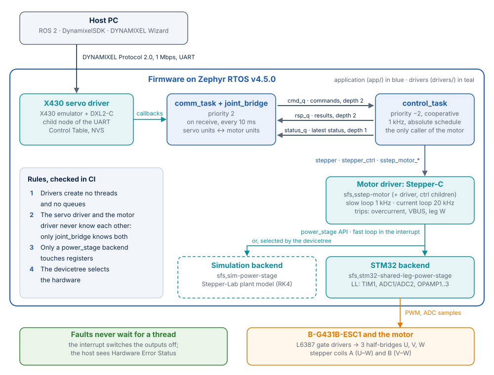

# Doppelstep

**Your stepper, seen as a smart servo.**

[](https://github.com/SystemFromScratch/sfs-doppelstep/actions/workflows/ci.yml)
[](https://systemfromscratch.github.io/sfs-doppelstep/)
[](docs/technology.md#zephyr-rtos)
[](docs/firmware-update.md)
[](docs/dynamixel.md)
[](docs/hardware.md)
[](docs/testing.md)
[](LICENSE)

<p align="center">
  
</p>

Doppelstep is open-source **Zephyr RTOS** firmware that turns a two-phase stepper motor and
the STMicroelectronics **B-G431B-ESC1** motor-control board into a **DYNAMIXEL XM430-W350**
smart servo. ROS 2 `dynamixel_hardware_interface`, DynamixelSDK and DYNAMIXEL Wizard talk to
it unchanged, for example as a joint of an OpenMANIPULATOR-X robot arm. Under the hood,
[Stepper-C](https://github.com/AntonVynohradov/Stepper-C) controls the coil currents in
closed loop at 20 kHz, MCUboot accepts only signed firmware, and the whole firmware is tested
on a PC against a physical model of the motor before it reaches the hardware.

It is a complete, documented firmware product, published under the Apache License 2.0 so that
you can repeat it step by step, or build your own product on it.

### Try it in your browser

[](https://codespaces.new/SystemFromScratch/sfs-doppelstep?quickstart=1&devcontainer_path=.devcontainer%2Fcodespaces%2Fdevcontainer.json)

The codespace starts from the published environment image with Zephyr, the toolchain and the
libraries already in place: nothing to install, nothing to download at the start. In its
terminal:

```bash
bash scripts/run-tests.sh                                          # firmware on native_sim + 28 SIL and integration tests
west build -p always --sysbuild -b b_g431b_esc1 -s app -d build   # MCUboot + signed firmware for the board
```

The first command builds the firmware as a Linux program with a simulated stepper motor and
drives it over DYNAMIXEL Protocol 2.0 the way ROS 2 does; the second builds the images you
would flash on a B-G431B-ESC1. A codespace with 4 cores is used; GitHub's free monthly
Codespaces hours cover many runs.

Full documentation, also as a PDF manual:
**[systemfromscratch.github.io/sfs-doppelstep](https://systemfromscratch.github.io/sfs-doppelstep/)**.

## Why it is worth a look

- **Drop-in for the host.** The complete Control Table of an XM430-W350 (model 1020), checked
  as the real servo checks it. An integration test runs the ros2_control loop with the
  official DynamixelSDK at 100 Hz against the firmware.
- **Real-time motor control.** Closed-loop microstepping current control in a 20 kHz
  zero-latency interrupt; overcurrent, bus voltage and shared-leg faults switch the outputs
  off inside that interrupt.
- **Tested before hardware.** The same firmware runs on a PC (`native_sim`) with the motor
  model of Stepper-Lab and power stage values from ngspice: 91 automated tests on every CI run.
- **Real Zephyr engineering.** Own driver class for the power stage, the motor behind Zephyr's
  `stepper` / `stepper_ctrl` APIs, an out-of-tree board, devicetree bindings, and layer rules
  enforced in CI.
- **Field update over the servo bus.** MCUboot serial recovery with an RSA-2048 signature;
  the bench GUI verifies the uploaded image by its hash.
- **Reproducible anywhere.** Pinned versions, a Docker image published for CI and GitHub
  Codespaces, a Dev Container, and the same VS Code tasks on Windows and Linux.

## At a glance

Measured with the CI build of this version.

| Item | Value |
|---|---|
| Board | STMicroelectronics B-G431B-ESC1: STM32G431CB, Cortex-M4F, 170 MHz, 128 KiB flash, 32 KiB RAM |
| Motor | Two-phase stepper (tested: 17HS19-2004S1, NEMA 17), 3200 microsteps per revolution |
| Control | Current loop 20 kHz, motion loop 1 kHz |
| Application size | 77 324 B flash (of the 87 712 B slot), 19 032 B RAM |
| Bootloader | MCUboot, 37 148 B |
| Tests | 55 ztest cases, 28 SIL and integration tests, 8 fixed-point motion tests |

## Architecture

<p align="center">
  
</p>

Three Zephyr drivers and an application that owns the threads. Faults are handled in the
20 kHz interrupt, independent of any thread. Layers, rules and the path of a command:
[docs/architecture.md](docs/architecture.md).

## Technology stack

| Layer | Technology |
|---|---|
| RTOS and bootloader | Zephyr RTOS v4.5.0 (sysbuild, devicetree, Kconfig), MCUboot |
| Motor control | [Stepper-C](https://github.com/AntonVynohradov/Stepper-C) v1.2.0 |
| Servo protocol | [DYNAMIXEL X430 Control Table Emulator](https://github.com/AntonVynohradov/DYNAMIXEL-X430-Control-Table-Emulator), [DXL2-C](https://github.com/AntonVynohradov/DXL2-C) v1.0.0 |
| Simulation | [Stepper-Lab](https://github.com/AntonVynohradov/Stepper-Lab) plant model, [sfs-stepper-power-spice](https://github.com/AntonVynohradov/sfs-stepper-power-spice) (ngspice), Zephyr native_sim |
| Hardware access | STM32Cube LL, CMSIS 6, SEGGER RTT |
| Tests and CI | ztest, Twister, pytest, DynamixelSDK, GitHub Actions, GitHub Container Registry |
| Environment | Docker, Zephyr SDK 1.0.1, west, Dev Container, GitHub Codespaces, VS Code, OpenOCD, J-Link |
| Host tools | Python: Tkinter GUI with matplotlib, pyserial, smpmgr |

What each one does, which version, and why it was chosen:
[docs/technology.md](docs/technology.md).

## Quick start on your PC, no hardware

You need Docker and Git:

```bash
git clone https://github.com/SystemFromScratch/sfs-doppelstep.git doppelstep
cd doppelstep
docker compose build                                         # toolchain image
docker compose run --rm zephyr bash scripts/west-init.sh     # Zephyr and the libraries
docker compose run --rm zephyr bash scripts/run-tests.sh     # firmware + SIL and integration tests
```

Then run the simulated servo and move it:

```bash
docker compose run --rm zephyr west build -b native_sim/native/64 -s app -d build-native
docker compose run --rm -p 5555:5555 zephyr python3 tools/sim/run_native.py run --tcp 5555
python tools/sim/dxl_smoke_test.py --tcp localhost:5555      # second terminal
```

On the board, with the simulated or the real motor, and in GitHub Codespaces:
[docs/getting-started.md](docs/getting-started.md).

## Documentation

The documentation is a MkDocs Material site with a printable PDF manual, built from
[`docs/`](docs/):

```bash
pip install -r requirements.txt
mkdocs serve                       # http://127.0.0.1:8000
python tools/docs/build_pdf.py     # site/Doppelstep.pdf
```

| Guide | How it works | Development |
|---|---|---|
| [Introduction](docs/overview.md) | [Architecture](docs/architecture.md) | [Development environment](docs/development.md) |
| [Technology stack](docs/technology.md) | [Simulated motor](docs/simulation.md) | [Tests and CI](docs/testing.md) |
| [Getting started](docs/getting-started.md) | [Firmware update](docs/firmware-update.md) | [Hardware checklist](docs/hardware-checklist.md) |
| [Hardware and bring-up](docs/hardware.md) | [Porting to a new MCU family](docs/porting.md) | [GUI](docs/gui/index.md) |
| [DYNAMIXEL emulation](docs/dynamixel.md) | | [Naming](docs/NAMING.md) |
| [Configuration](docs/configuration.md) | | [Author & Company](docs/about.md) |

## Status

Doppelstep is under active development. Before you run a real motor, read the open items in
[docs/overview.md](docs/overview.md#status-and-known-limits): the dead time of the power stage
must be set first, lost steps are not detected yet (no encoder), and the latest driver
refactor still has to be checked on the board.

## Author

Doppelstep is designed, written and maintained by **Anton Vynohradov**, Embedded Systems
Engineer and founder of **SystemFromScratch®**: firmware and embedded Linux for connected
products, secure, MISRA-compliant and ready for the EU Cyber Resilience Act.

[systemfromscratch.github.io](https://systemfromscratch.github.io/) ·
[avynohradov@systemfromscratch.com](mailto:avynohradov@systemfromscratch.com) ·
[LinkedIn](https://www.linkedin.com/in/vynohradov) ·
[ORCID 0009-0005-6965-0911](https://orcid.org/0009-0005-6965-0911)

Need firmware like this for your product, Zephyr drivers, a bootloader or CRA readiness? Get
in touch.

## License and trademarks

Application, drivers, board, module glue, configuration, tests, tools and documentation:
Apache License 2.0 ([LICENSE](LICENSE)). Zephyr RTOS, the Zephyr SDK, MCUboot, Stepper-C, the
DYNAMIXEL X430 emulator, DXL2-C, STM32Cube HAL/LL and SEGGER RTT come under their own
licenses ([docs/license.md](docs/license.md)). The SEGGER J-Link Software is not part of the
repository or the image unless you add it yourself under SEGGER's license.

SystemFromScratch® is a registered trademark. The Apache License 2.0 grants no rights to use
the SystemFromScratch® name or logo; they may not be used to endorse or promote products
derived from Doppelstep without prior written permission. DYNAMIXEL and ROBOTIS are
trademarks of ROBOTIS Co., Ltd.; STM32 is a registered trademark of STMicroelectronics
International N.V. Doppelstep is not affiliated with or endorsed by them.
