# Author & Company

{ .sfs-brand__logo }

Doppelstep is designed, written and maintained by **Anton Vynohradov** and published by
**SystemFromScratch®**: firmware and embedded Linux for connected products, secure,
MISRA-compliant and ready for the EU Cyber Resilience Act.

## Author

**Anton Vynohradov** · [ORCID 0009-0005-6965-0911](https://orcid.org/0009-0005-6965-0911)
{ .sfs-author__name }

Embedded Systems Engineer · Founder of SystemFromScratch®
{ .sfs-author__role }

*Zephyr, Embedded Linux, MISRA, CRA.*

Anton founded SystemFromScratch® to help industrial IoT, automotive, robotics, medical and
consumer electronics teams turn hardware into secure, maintainable products. He designs and
writes the software: firmware, drivers, RTOS and embedded Linux, security and compliance. For
hardware design he works with experienced partner engineers, so a customer has one point of
contact from the first board on the bench to the product in the field. He is based in Poland
and works remotely worldwide.

For Doppelstep, Anton wrote the firmware, its drivers and board support, the Stepper-C,
DXL2-C and X430 emulator libraries it is built on, the simulation models, the tests, the
development environment, the bench GUI and this documentation.

## SystemFromScratch®

SystemFromScratch® is one partner for the whole software stack of an embedded product:
firmware, operating systems, security and regulation, with specialist hardware engineers
joining when a project needs them.

| Service | What it covers |
| --- | --- |
| Embedded software development | Bare-metal, RTOS and Linux application firmware in C/C++, including OTA, built for performance, reliability and long-term maintainability |
| BSP & device drivers | Board support packages, bootloaders and low-level drivers for MCUs, SoCs, FPGAs and custom hardware, including Zephyr drivers and Linux kernel work |
| RTOS & Embedded Linux | Porting, configuration, integration and reproducible builds for Zephyr, FreeRTOS and Embedded Linux (Yocto, Buildroot) |
| Hardware bring-up & integration | The firmware side of first boot, validation and production, including motor-control platforms; hardware design through trusted partners |
| Cybersecurity & CRA readiness | Secure boot, firmware integrity, threat modelling and a secure development lifecycle for the EU Cyber Resilience Act |
| Compliance & consulting | MISRA C/C++, static analysis, code and architecture reviews, compliance roadmaps |

Doppelstep is one of the open-source projects of the SystemFromScratch® portfolio: public
engineering work that can be inspected line by line. It shows several of these services in
one real product: Zephyr drivers and an out-of-tree board, a signed bootloader with field
update, motor control in a hard real-time interrupt, an industrial protocol, tests against a
physical model, and a reproducible environment.

## Use it, build on it

Doppelstep is licensed under the Apache License 2.0 ([License](license.md)). You may use it,
change it and build your own products on it, commercially too, under the terms of that
license. It is meant to be repeated: every step from an empty PC to a moving motor is
documented, and every number in this documentation can be re-measured from the sources.

## Contact

| Channel | Address |
| --- | --- |
| Website | [systemfromscratch.github.io](https://systemfromscratch.github.io/) |
| E-mail | [contact@systemfromscratch.com](mailto:contact@systemfromscratch.com) |
| GitHub | [github.com/AntonVynohradov](https://github.com/AntonVynohradov) |
| GitHub organization | [github.com/SystemFromScratch](https://github.com/SystemFromScratch) |
| LinkedIn | [linkedin.com/in/vynohradov](https://www.linkedin.com/in/vynohradov) |
| ORCID | [0009-0005-6965-0911](https://orcid.org/0009-0005-6965-0911) |
| Location | Poland, working remotely worldwide |

Building a connected product, bringing up new hardware, or preparing for the Cyber
Resilience Act? Get in touch through
[systemfromscratch.github.io](https://systemfromscratch.github.io/) or by e-mail.

## Support and feedback

- **Bugs and feature requests:** open an issue on
  [GitHub](https://github.com/SystemFromScratch/sfs-doppelstep/issues). Please include the
  commit or version, the build command and board, the log (RTT or `native_sim` output), and
  the steps or the test that show the problem.
- **Contributions:** follow the [architecture rules](architecture.md#four-rules); the layer
  check and the tests must pass ([Tests and CI](testing.md)).
- **Commercial support, integration and custom development:** contact SystemFromScratch®
  through [systemfromscratch.github.io](https://systemfromscratch.github.io/).

## Trademarks and acknowledgements

SystemFromScratch® is a registered trademark. The SystemFromScratch® name and logo are used
in this documentation to identify the publisher of Doppelstep; the Apache License 2.0 grants
no rights to use them, and they may not be used to endorse or promote products derived from
Doppelstep without prior written permission.

DYNAMIXEL and ROBOTIS are trademarks of ROBOTIS Co., Ltd. STM32 is a registered trademark of
STMicroelectronics International N.V. Arm and Cortex are trademarks of Arm Limited. Hardware
and protocol names are used only to describe compatibility; Doppelstep is not affiliated
with or endorsed by their owners.

Doppelstep builds on the work of the Zephyr Project, MCUboot, STMicroelectronics (STM32Cube),
SEGGER (RTT) and ROBOTIS (DynamixelSDK, the published Control Table of the XM430-W350).
