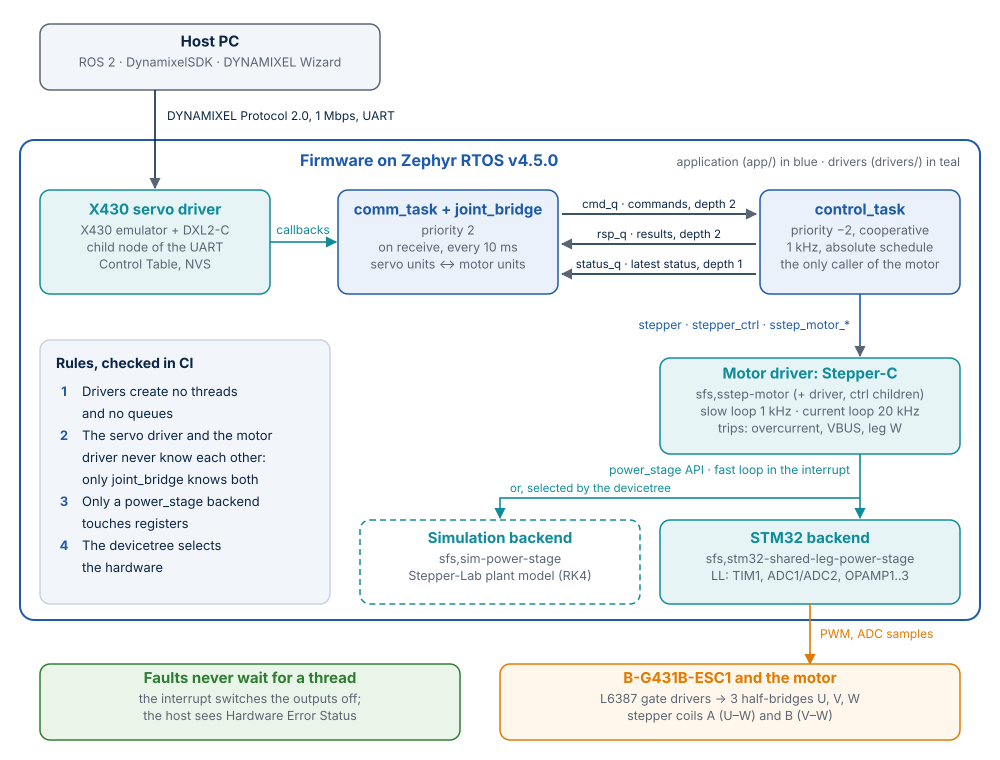
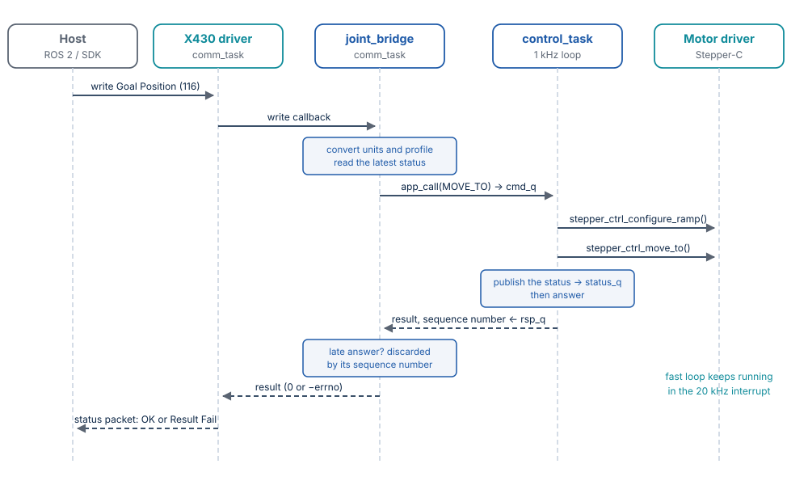

# Architecture

Doppelstep is a Zephyr module with one application. Hardware and libraries sit behind
drivers. The application owns the threads and the queues and connects the drivers. This page
explains the layers, their rules and the path of a command, so you can read the code or add to
it. For a new MCU, continue with [Porting to a new MCU family](porting.md).



## Layout

```text
doppelstep/
├── zephyr/module.yml     the repository is a Zephyr module
├── CMakeLists.txt, Kconfig   build modules/ and drivers/
├── app/                  application: tasks, queues, register mapping
├── drivers/              power_stage/, motor/, x430/
├── include/doppelstep/drivers/   public driver APIs
├── dts/bindings/         devicetree bindings and the sfs vendor prefix
├── boards/               out-of-tree board
├── modules/              build glue of the libraries
└── tests/                ztest suites and pytest SIL and integration tests
```

The layout follows the Zephyr `example-application`. West finds the module because the manifest
repository is a west project, so the application and every test application get the drivers,
the board and the bindings without extra CMake.

## Four rules

1. **Drivers create no threads and no queues.** A driver offers a function such as
   `sstep_motor_process()` or `x430_servo_process()`, and the application calls it from a loop
   it owns. The only exception is the fast loop, which stays in the interrupt inside the driver.
2. **The X430 driver does not know the motor, and the motor driver does not know DYNAMIXEL.**
   Only `app/src/joint_bridge.c` knows both, so X430 units never reach the motor driver.
3. **Only a `power_stage` backend touches registers.** LL calls, the cycle counter, OPAMPs and
   direct interrupts appear nowhere else.
4. **The devicetree selects the hardware.** The `power-stage` phandle of the motor selects the
   backend, the servo is a child node of its UART, and a phandle selects the flash partition.

`scripts/check-layers.sh` enforces rules 2 and 3 in CI, and also rejects floating point above
the backends and any output switching in the simulation backend.

## Drivers

| Driver | Compatible | API |
|---|---|---|
| Power stage, STM32 | `sfs,stm32-shared-leg-power-stage` | Class `power_stage` (`power_stage.h`) |
| Power stage, simulation | `sfs,sim-power-stage` | Class `power_stage`, plus `power_stage_sim.h` |
| Motor (Stepper-C) | `sfs,sstep-motor` with the children `sfs,sstep-stepper-driver` and `sfs,sstep-stepper-ctrl` | Zephyr classes `stepper` and `stepper_ctrl`, plus `sstep_motor.h` |
| Servo (X430 emulator) | `sfs,x430-servo`, a child of the UART | `x430_servo.h` |

**Why a custom class for the power stage?** Zephyr's PWM API has no dead time, center alignment
or complementary outputs, and its ADC API has no timer-triggered injected conversions. A 20 kHz
current loop needs all of them, so MCU-specific code is unavoidable. The `power_stage` class
keeps that code in one file per MCU family, the way Zephyr does for its own driver classes.

**Why three nodes for the motor?** Zephyr splits stepper devices into a hardware driver
(`stepper`: enable, disable, microsteps) and a motion controller (`stepper_ctrl`: moves, ramp,
position). Integrated chips such as `adi,tmc50xx` use a parent node with one child for each
class, and Stepper-C plays the same role. What the classes lack (slow loop, status, currents,
faults) is the extension on the parent node.

## Contexts

| Context | Priority | Rate | Work | Never |
|---|---|---|---|---|
| Interrupt of the backend | Highest (on the STM32: zero-latency ADC1_2 interrupt) | PWM rate, 20 kHz | Currents and VBUS, shared-leg trip, fast loop `sstep_fast_loop()`, immediate shutdown on a fault | Kernel calls |
| `control_task` | −2, cooperative | 1 kHz, absolute schedule | Slow loop `sstep_motor_process()`, commands, publication of the status | Waiting on an outgoing queue |
| `comm_task` | 2 | On receive, and every 10 ms | `x430_servo_process()`, `joint_bridge`, live registers | Calling the motor driver |
| `main` | 0 | — | Startup, then the STATUS LED | Sending commands |

Every call into the motor driver comes from `control_task`, so the driver needs no lock for its
status. With `CONFIG_ASSERT` the driver checks this.

## Queues

`app/src/app_msg.h` defines three queues. Messages travel by value.

| Queue | Direction | Depth | Use |
|---|---|---|---|
| `cmd_q` | comm → control | 2 | Commands, with a sequence number |
| `rsp_q` | control → comm | 2 | Results, 0 or `-errno` |
| `status_q` | control → readers | 1 | Latest status only |

`control_task` never waits on an outgoing queue, so communication cannot stall the control loop.
`app_call()` waits at most `CONFIG_SFS_CMD_TIMEOUT_MS` and discards a late answer by its sequence
number, so `comm_task` cannot hang either. A command that timed out may still execute later, and
the log records the timeout.

## A command, from the bus to the motor

Goal Position:



The host gets the result in the status packet, so `joint_bridge` waits for it. Because the status
is published before the answer, the sender always sees a status that reflects its command.

| Situation | Reaction | Host sees |
|---|---|---|
| The driver rejects a command | Result in `rsp_q` | Result Fail |
| Unsupported Operating Mode | `joint_bridge`, motor not involved | Data Range Error |
| Overcurrent, bus voltage, stall | Outputs off in the interrupt, flag in the status | Hardware Error Status, Torque Enable 0 |
| `cmd_q` full, or no answer in time | `-EBUSY` or `-ETIMEDOUT`, log entry on a timeout | Result Fail |

Motor protection depends on no task, because the interrupt handles electrical faults.

## Startup

On the board MCUboot runs first: it checks the signature of the application and waits 500 ms
for a firmware update over USART2 ([Firmware update](firmware-update.md)). Then the
application starts:

1. Device initialisation at `POST_KERNEL`: power stage, motor driver, servo. Outputs stay off.
2. `main` checks the devices and measures the current sensor offsets.
3. `main` starts `control_task`, which publishes the first status, and connects the servo through
   `joint_bridge`.
4. `main` starts `comm_task` and continues with the LED.

The fast-loop interrupt already runs after step 1, while the motor driver is ready and the sensor
offsets are not yet known. That is safe because the outputs are off, the current trips of Stepper-C
only act when the outputs are on, and `POWER_STAGE_TRIP_AUX` stays clear until calibration has
succeeded.

**Fast-loop overrun.** The fast loop runs in a zero-latency interrupt above every thread. If it
does not finish within its PWM period, the next measurement is ready before it returns and the
interrupt starts again at once: no thread runs any more, also not the bus task that would switch
the motor off. The backend therefore checks, after every callback, whether the next measurement
has already finished. If it has, it switches the outputs off in the interrupt itself and passes
`POWER_STAGE_TRIP_OVERRUN` with the next sample. With the outputs on, the motor driver reports
it as `SSTEP_FAULT_HAL`, the fault keeps the outputs off, the cheap fault state frees the CPU,
and the bus answers again with Electrical Shock Error in Hardware Error Status. With the outputs
off a late period is harmless and no fault latches: a flash write of the EEPROM area, allowed
only with the torque off, stalls the CPU for many periods on the STM32G431.
`power_stage_get_stats()` counts every overrun, also those.

**Trips and self-test.** The STM32 backend checks the current of every leg in the interrupt
and passes `POWER_STAGE_TRIP_AUX`; its comparators switch the outputs off in hardware through
the break inputs of TIM1 and pass `POWER_STAGE_TRIP_HW_OC` or `_HW_OV`. The motor driver latches
each trip as a fault. Before the first enable, `stepper_enable()` runs
`sstep_selftest()` of Stepper-C, which also checks the bus voltage: for a few tens of
milliseconds the fast loop of the library drives the legs itself, the fast callback adds up
the three leg currents, and the control task waits. `CONFIG_SFS_CMD_TIMEOUT_MS` (150 ms) is
longer than that, so the host gets the result of Torque Enable, not a timeout
([Protection](protection.md)).

**Watchdog.** A fast loop can also take almost the whole period without overrunning it: then the
threads get too little time, and the overrun check sees nothing. The independent watchdog (IWDG)
covers that and any hung task (`app/src/supervisor.h`). The control task and the communication
task check in from their loops; `main()` checks every 100 ms and feeds the watchdog only if both
have checked in since the last check. A task that stops for 500 ms resets the MCU, and a reset
switches the outputs off. The watchdog starts after the offset calibration and before the tasks,
so without a working watchdog the tasks never start. A debugger that halts the CPU halts the
watchdog too. After a watchdog reset the log says so. Measured on the board: with the feeding
stopped, the reset follows 0.45 to 0.8 s later, with IWDGRSTF set in `RCC_CSR`, and the torque is
off afterwards.

Until step 3 finishes, nothing can send an enable command, so the motor cannot start with
uncalibrated sensors. On an error in steps 1 or 2 the tasks do not start. In every error case the
outputs stay off and the LED blinks fast.

## Configuration

| What | Where |
|---|---|
| Motor, limits, tuning, joint, power stage, PWM, scaling | Devicetree properties (`app/boards/*.overlay`) |
| Compiled features, threads, buffers, timeouts | Kconfig |
| Board-specific Zephyr options | `app/boards/<board>.conf` |
| Simulated motor on the board | `-DEXTRA_DTC_OVERLAY_FILE=sim.overlay` |
| Bootloader, flash layout, serial recovery | `app/sysbuild.conf`, `app/sysbuild/`, partitions in the board devicetree |
