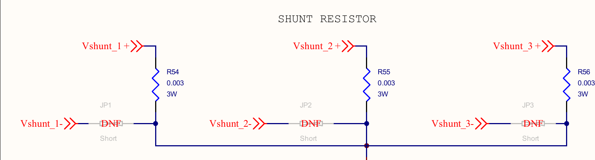

# Dead time of the power stage

The two MOSFETs of a half-bridge must never conduct at the same time: with both on, the bus
is shorted through the leg and the current is limited only by the resistance of the switches
and the layout. This **shoot-through** destroys the MOSFETs within a few edges. The timer
therefore delays every turn-on by a fixed **dead time** after the turn-off of the other
switch of the same leg.

The user manual of the B-G431B-ESC1 (UM2516) does not give a dead time, and a value copied
from another board is not safe: it depends on the gate circuit. This page derives the value
from the schematic and a circuit simulation, step by step, so that anybody can repeat it,
for this board or for another one.

!!! success "Result"
    `dead-time-ns = <1200>` in `app/boards/b_g431b_esc1.overlay`. The simulation shows
    shoot-through up to 600 ns and a first clean value at 900 ns; 1200 ns adds a margin of
    1.3. **Confirm it on the board before the first motor run**
    ([bring-up step 1](hardware.md#bring-up-checklist)).

## Where the dead time is set

| Layer | What happens |
|---|---|
| Devicetree | `dead-time-ns` of the power stage node in `app/boards/b_g431b_esc1.overlay`. 0 means "not set": the driver then refuses to enable the outputs |
| Driver | `drivers/power_stage/power_stage_stm32.c` converts it to timer clock periods, rounded up: 1200 ns × 170 MHz = **204 ticks** (5.88 ns each) |
| Timer | TIM1 inserts it on every complementary pair CHx / CHxN through the DTG field of `TIM1_BDTR`. 204 ticks need the second DTG range, (64 + DTG[5:0]) × 2 ticks, so DTG = 0x80 \| 38 = **0xA6** |
| Log | At startup: `TIM1: 170000000 Hz clock, ARR 4250 (20000 Hz), dead time 1200 ns (204 ticks)` |

The gate driver itself, an L6387ED, adds **no** dead time. Its interlocking only keeps both
outputs low when both inputs are high, which does not protect against a slow turn-off.

## What limits the dead time

The timer dead time starts at the command to switch off. The MOSFET is off later, when its
gate has discharged below the threshold VGS(th). Two effects decide whether the time between
is long enough:

1. **Turn-off time.** The gate charge leaves through the sink stage of the driver and the
   gate resistor. The larger the gate resistor, the longer the turn-off, and the longer the
   dead time must be.
2. **Miller bump.** When the other switch turns on, the phase node moves by the bus voltage
   in a few tens of nanoseconds. The gate-drain capacitance Cgd of the switch that is off
   couples this edge into its gate. The resulting current through the gate resistor lifts
   the gate voltage for a moment. If the gate has not fully discharged yet, the bump starts
   from a higher level and can cross VGS(th): a short shoot-through at every edge, although
   the gate signals never overlap.

So three criteria must hold, checked in this order:

| Criterion | Meaning |
|---|---|
| Gate gap > 0 | The off gate is below VGS(th) before the other gate rises above it |
| Miller bump < VGS(th) | The off gate stays below the threshold at the edge of the other switch |
| No extra bus current | The peak current drawn from the bus is only the charge of the switch node (Coss, snubber), not a short through the leg |

The first criterion is the one a datasheet calculation gives. On this board the second one
is the stricter one, as the results below show.

## Step 1: the gate circuit from the schematic

The schematic of the board, **MB1419 rev C**, is part of the B-G431B-ESC1 documentation on
st.com (file `mb1419-g431cbu6-c01_schematic.pdf`). Sheet 5, POWER, contains everything that
sets the switching times. The three legs are identical; leg U is shown.




| Value | Parts (legs U, V, W) | Value on MB1419 rev C | Effect on the dead time |
|---|---|---|---|
| Gate driver | U10, U11, U13 | L6387ED, interlocking, no dead time of its own | Delay about 105 to 110 ns, sink about 650 mA |
| Driver supply | +10V rail (U9, R30, R33) | 10 V | Gate voltage when on; less charge to remove than at 12 or 15 V |
| Gate resistor | R34, R38 / R40, R43 / R47, R50 | **33 Ω**, no turn-off diode | Sets the turn-off time. The largest effect |
| Gate pull-down | R35, R39 / R41, R45 / R48, R52 | 10 kΩ | Keeps an unpowered gate off; negligible for the timing |
| MOSFET | Q2 to Q7 | STL180N6F7 | Gate charge and Cgd (Miller bump) |
| Bootstrap | D6, C43 / D8, C52 / D9, C58 | STPS0560Z, 1 µF | High-side supply; not timing relevant |
| Snubber | R37, C51 / R44, C59 / R51, C65 | 1 Ω + 10 nF to ground | Slows the edge of the phase node at low current |
| Shunt | R54, R55, R56 | 3 mΩ | Part of the leg; small effect |
| Input filter | C47, C48 / C53, C54 / C60, C61 | 100 pF, no series resistor | Negligible delay at the MCU pin |

## Step 2: a first estimate by hand

Below the Miller plateau, the gate of the switch that turns off discharges like an RC
circuit, through the sink of the driver (about 18 Ω, from the 650 mA sink current) and the
gate resistor, into the input capacitance Ciss (4825 pF at 25 V in the datasheet):

```text
tau      = (R_sink + R_g) * C_iss = (18 + 33) Ohm * 4.825 nF = 246 ns
t(10 V -> 3 V) = tau * ln(10 / 3)                          = 296 ns
t_off   >= t_driver + t(10 V -> 3 V) = 105 ns + 296 ns      ≈ 400 ns
```

The same estimate with 10 Ω gives about 270 ns: the 33 Ω resistors make the turn-off about
1.8 times slower. That explains why a dead time chosen for a board with small gate resistors
is not safe here.

This is a **lower bound** and not a dead time:

- Ciss is larger than the datasheet value at 25 V, because the switch that turns off has
  almost no drain-source voltage at first, and Cgd rises steeply at low VDS.
- The **Miller plateau** is missing: while the phase node moves, the gate stays at about
  3.1 V and the gate current, about 3.1 V / 51 Ω = 61 mA, only charges Cgd. Its length
  is Qgd / I_gate and depends on the current and the snubber.
- The Miller bump of the other edge cannot be estimated reliably by hand.

The waveform below shows these phases: the RC discharge from 110 to 600 ns, the plateau
from 600 to 950 ns, and only then the drop below VGS(th). The real turn-off takes more than
twice the hand estimate. A simulation is needed.

## Step 3: the ngspice sweep

The ngspice model of one leg, `sfs-stepper-power-spice`
([Simulated motor](simulation.md#parameters)), contains:

| Model | Content |
|---|---|
| `models/l6387_behav.lib` | L6387E behavioural: interlocking, about 107 ns delay, 30 Ω source, 18 Ω sink, bootstrap |
| `models/stl180n6f7_sfs.lib` | STL180N6F7 as a VDMOS model fitted to the datasheet: Rds(on), body diode, Ciss / Coss / Crss, Qg |
| `circuits/esc1_leg.lib` | One leg: driver, two MOSFETs, gate resistors, bootstrap, shunt, layout inductances |

`tools/power/deadtime_sweep.py` uses this model with the values of step 1 and adds the
parts the leg model does not contain yet: the 10 kΩ gate-source resistors and the snubber.
For each timer dead time from 300 to 1500 ns in steps of 100 ns, at junction temperatures of
25 °C and 100 °C, it simulates the leg at 24 V, 20 kHz, duty 0.5, with phase currents of
−3, −0.25, +0.25 and +3 A, and keeps the worst case of the three criteria.

```bash
# ngspice (42 or newer) in PATH, or NGSPICE=<path to ngspice_con.exe>
python tools/power/deadtime_sweep.py sweep        # about 15 minutes -> build/deadtime/sweep.csv
python tools/power/deadtime_sweep.py plot         # the figures of this page
python tools/power/deadtime_sweep.py schematic --pdf mb1419-g431cbu6-c01_schematic.pdf
```

In the west workspace the model is found at `modules/lib/sfs-stepper-power-spice`. Elsewhere,
pass `--spice <path>` or set `SFS_POWER_SPICE`. The board values are the `BOARD` table at the
top of the script, with the schematic reference of each value.

## Step 4: results


| Timer dead time | Gate gap, 25 / 100 °C | Miller bump, 25 / 100 °C | Peak bus current, 25 / 100 °C | Verdict |
|---|---|---|---|---|
| 300 ns | gates overlap | 4.61 / 4.68 V | **111 / 88 A** | Shoot-through |
| 400 ns | 21 / 21 ns | 4.30 / 4.35 V | **66 / 52 A** | Shoot-through |
| 500 ns | 28 / 32 ns | 4.02 / 4.07 V | **39 / 31 A** | Shoot-through |
| 600 ns | 114 / 122 ns | 3.79 / 3.82 V | **22 / 17 A** | Shoot-through |
| 700 ns | 205 / 200 ns | 3.61 / 3.65 V | 11.4 / 9.5 A | Short pulses at every edge |
| 800 ns | 281 / 277 ns | 3.52 / 2.98 V | 9.0 / 8.5 A | Bump at the threshold |
| **900 ns** | 365 / 361 ns | **2.79 / 2.73 V** | 9.0 / 8.5 A | **First clean value** |
| 1000 ns | 450 / 446 ns | 2.60 / 2.54 V | 9.0 / 8.5 A | Clean |
| 1100 ns | 539 / 537 ns | 2.45 / 2.39 V | 9.0 / 8.5 A | Clean |
| **1200 ns** | 632 / 630 ns | 2.34 / 2.27 V | 9.0 / 8.5 A | **Chosen** |
| 1300 ns | 726 / 724 ns | 2.25 / 2.19 V | 9.0 / 8.5 A | Clean |
| 1500 ns | 918 / 916 ns | 2.13 / 2.06 V | 8.9 / 8.4 A | Clean |

The 9 A floor of the bus current is the charge of the switch node: the output capacitance
of the MOSFETs and the 10 nF of the snubber, charged to 24 V within a few tens of
nanoseconds. It does not change with the dead time, so it is not a short.


## Step 5: the chosen value and the margin

The simulation gives **900 ns** as the smallest dead time that meets all three criteria at
25 °C and at 100 °C. The firmware uses **1200 ns**, about 1.3 times that, because the model
is not exact in the directions that make the real minimum larger:

- **VGS(th).** The criterion uses 3 V. The threshold of a real MOSFET spreads between
  parts and falls when it gets hot. The fitted model hardly changes its threshold with
  temperature, which is why the 25 °C and 100 °C curves are so close. A lower threshold
  raises the minimum dead time.
- **Driver delay mismatch.** The model gives both channels of the L6387E the same delay.
  A real driver turns one channel off later than it turns the other on, and the difference
  uses up part of the margin.
- **MOSFET model.** The model is fitted to the datasheet by this project; it is not the
  model of the manufacturer.

The price of a longer dead time is small at 20 kHz. The phase voltage error grows by about
1.2 µs / 50 µs = 2.4 % of the bus voltage per leg, and the current loop corrects it. The
largest leg duty at which the shunt current can still be sampled falls from about 0.95 to
0.93. The shared-leg drive of this motor works well below that.

## Step 6: check on the board

A simulation narrows the choice. It does not replace a measurement. Before connecting a motor:

1. Supply at 12 V with a current limit of about 200 mA. No motor connected.
2. Torque Enable over the bus. Without a load the current loop cannot reach its set point,
   so a leg may sit at a duty of 0 or 1 and show no edges. In that case connect a power
   resistor (for example 10 Ω, 10 W) between U and W in place of the motor.
3. Oscilloscope on the low-side VGS of one leg (gate and source of Q3, Q5 or Q7) and on the
   phase node. Use a differential probe for the high side, never a ground clip on the phase
   node.
4. The off gate must stay well below VGS(th) at every edge, and the supply current must
   stay small and steady. A current limit that trips, or MOSFETs that get warm, mean the
   dead time is too short: switch off at once.

Only after this measurement, and not below 900 ns, can the dead time be lowered. The full
procedure is [bring-up step 1](hardware.md#bring-up-checklist), and
[hardware checklist](hardware-checklist.md) check 5.

## Limits of the method

- The sweep covers one operating point: 24 V, 20 kHz, phase currents up to ±3 A. Repeat it
  for a higher bus voltage or a different gate circuit.
- Layout inductances (3 nH commutation loop, 1 nH shunt) are assumptions of the model, not
  values from the board layout.
- The leg voltage error table that the simulated motor uses
  ([Simulated motor](simulation.md#limits)) is still computed for 500 ns and 10 Ω. It is
  updated when the leg model of `sfs-stepper-power-spice` takes over the values of step 1.
- The dead time compensation of Stepper-C is not implemented yet (`dead_time_ns` is
  reserved). When it is, it must use the effective dead time seen in the phase voltage, not
  the 1200 ns of the timer.

## For another board

1. Read the gate circuit from its schematic: driver and its supply, gate resistors,
   turn-off diodes, MOSFET, snubber, shunt (step 1).
2. Make the hand estimate of step 2 to see the order of magnitude.
3. Enter the values in `BOARD` of `tools/power/deadtime_sweep.py`. For another driver or
   MOSFET, add its model to `sfs-stepper-power-spice` first.
4. Run the sweep, find the first value that meets all three criteria, add a margin, and
   measure it on the board before connecting a motor.
