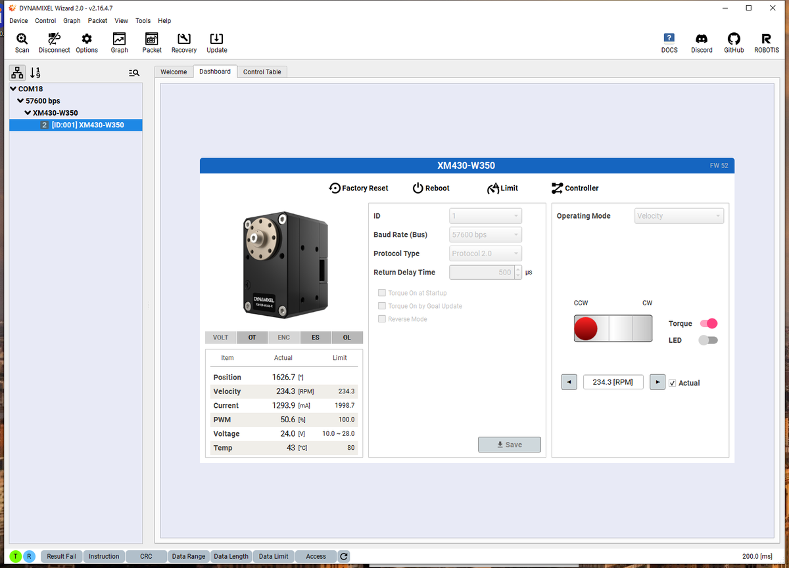
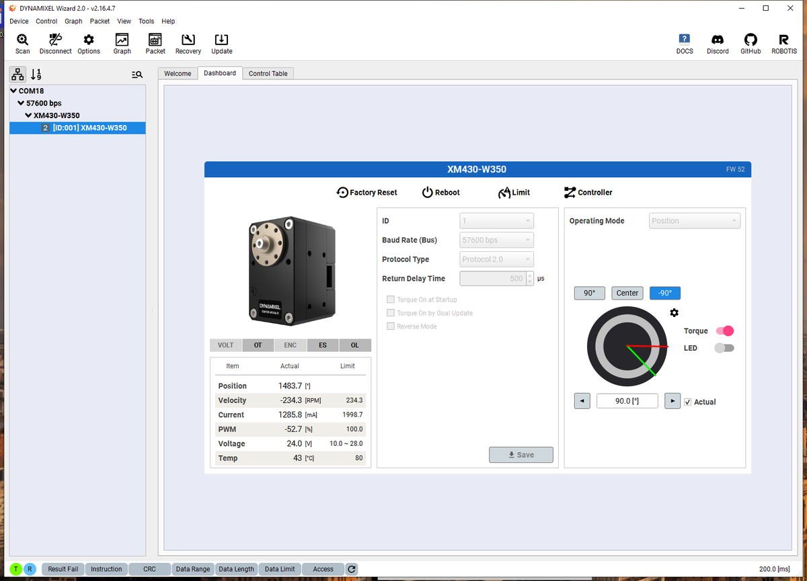
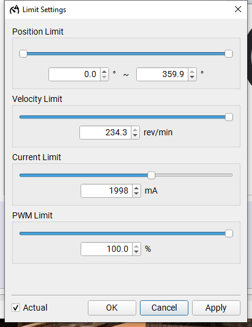
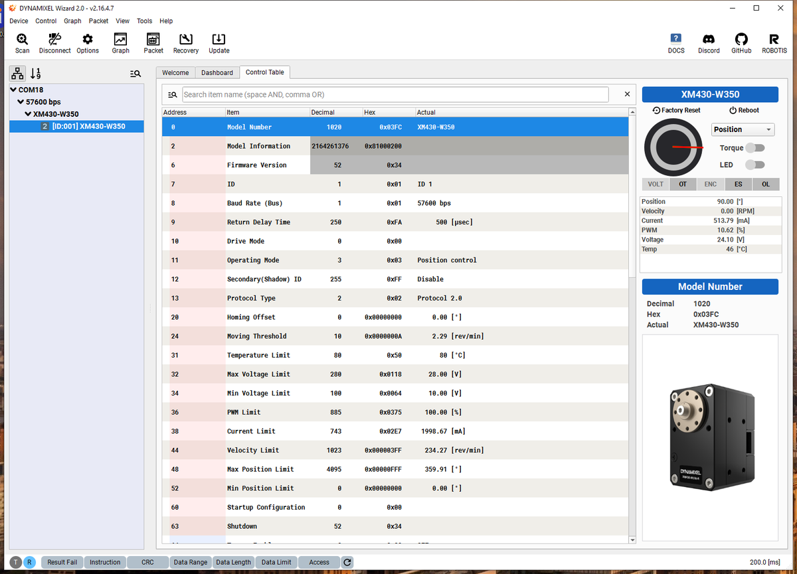

# DYNAMIXEL emulation

To a host program, Doppelstep is a **DYNAMIXEL XM430-W350** (model number 1020) with one ID,
speaking Protocol 2.0. The X430 emulator validates every access exactly as the servo does:
ranges and limits, the EEPROM lock, Indirect Addresses, Fast Sync/Bulk Read, the Bus
Watchdog. The firmware then maps the registers onto the motor (`app/src/joint_bridge.c`).
This page lists that mapping, the units, and what differs from a real XM430.

## Register mapping

| Register | Mapping |
|---|---|
| Torque Enable (64) | `stepper_enable()` / `stepper_disable()`; refused (Result Fail) while the dead time is not set or with a fault |
| Operating Mode (11) | 3 position, 4 extended position, 1 velocity; 0, 5, 16 are refused (Data Range Error) |
| Goal Position (116) | `stepper_ctrl_move_to()`; limits from Profile Velocity/Acceleration (velocity- or time-based, Drive Mode bit 2), Velocity Limit and the `max-velocity` / `max-acceleration` properties of the motor node |
| Goal Velocity (104) | `stepper_ctrl_run()` or `stepper_ctrl_stop()` (velocity mode) |
| Drive Mode (10) bit 0, Homing Offset (20) | Direction and offset of the position mapping |
| Current Limit (38) | Run current = min(limit × 2.69 mA, `rated-current-milliamp`). At startup and after a Factory Reset the run current is `run-current-milliamp` (1500 mA), whatever the register says; a host write raises or lowers it, up to the rated current (2000 mA) |
| Present Position (132), Position Trajectory (140) | Commanded position (no encoder) |
| Present Velocity (128), Velocity Trajectory (136) | Commanded velocity |
| Present Current (126) | Phase current amplitude √(iA² + iB²), averaged over 8 ms (one ADC step is 29 mA on the ESC1); 0 with the torque off |
| Model Information (2) | Version of the Doppelstep firmware from git at build time: byte 0 patch, 1 minor, 2 major, 3 commits after the release tag (bit 7: uncommitted changes); `0x00000200` = 0.2.0 ([Releasing](development.md#releasing)) |
| Firmware Version (6) | 52, as the XM430 firmware whose Control Table is emulated: DYNAMIXEL Wizard compares it with the ROBOTIS firmware |
| Present Input Voltage (144) | Measured VBUS (0.1 V) |
| Present PWM (124) | Amplitude of the commanded phase duty vector √(dA² + dB²), the part of VBUS across the coils, averaged over 8 ms; 885 = 100 %, as the PWM Limit of an XM430. Sign of Present Velocity (positive at rest); 0 with the torque off. A current drive: the current loop sets it, PWM Limit (36) is not applied |
| Present Temperature (146), Temperature Limit (31) | Power stage NTC in whole °C; above the limit Overheating Error, which switches the torque off until a Reboot ([Hardware](hardware.md#current-and-voltage-scaling)) |
| Moving (122), Moving Status (123) | From the status of the motor driver |
| Hardware Error Status (70) | Over/undervoltage, hardware overvoltage trip, Torque Enable outside the supply limits → Input Voltage; overcurrent, leg trip, hardware short-circuit trip, fast-loop overrun, failed self-test, current sensor offset fault → Electrical Shock; temperature above the limit or NTC fault → Overheating ([Protection](protection.md)) |
| LED (65) | STATUS LED of the board: 1 on, 0 off. An alarm (Hardware Error Status not 0, motor fault, startup error) makes it blink fast at 5 Hz whatever the register says, as the alarm LED of an XM430 |
| Bus Watchdog | `stepper_ctrl_stop()` |
| REBOOT / FACTORY_RESET | Outputs off, faults cleared; on the board (MCUboot) REBOOT then resets the MCU: silent for 500 ms plus startup, Present Position restarts ([Firmware update](firmware-update.md#dynamixel-reboot-on-the-board)) |
| CLEAR (multi-turn) | Position redefined within one turn |
| Baud Rate (8) | USART2 reconfigured after the status packet has left at the old rate (ten character times); stored in NVS, kept over a power cycle. Reconnect at the new rate |

## Units

The conversions are in `app/src/joint.c`:

| Quantity | DYNAMIXEL unit | Motor side |
|---|---|---|
| Position | 4096 pulses per joint revolution | 3200 microsteps per motor revolution (200 × 16) |
| Velocity | 0.229 rev/min | microsteps per second |
| Acceleration | 214.577 rev/min² | microsteps per second² |
| Current | 2.69 mA | mA |
| Gear | `gear-motor-revs / gear-joint-revs` of the servo node: 1/1, direct drive | |

With the 17HS19-2004S1 in direct drive one joint revolution is one motor revolution:
4096 pulses = 3200 microsteps, so one pulse is 0.78 microsteps and one full step (1.8°) is
20.48 pulses. The largest velocity of the motor node, `max-velocity` 16000 microsteps/s, is
5 rev/s = 300 rev/min = 1310 × 0.229 rev/min. For a gearbox, set the two properties to its
ratio (motor revolutions per joint revolution): position, velocity and acceleration then
count at the joint.

## Startup position

The motor has no encoder. At power-on the rotor position is reported as Present Position
**2048** (`start-position` of the servo node, 0 rad for `dynamixel_hardware_interface`):
power the joint up in that position. With the torque off the rotor can be moved by hand, and
the reported position is then no longer the real one.

## Factory values and the EEPROM

| Value | Doppelstep | A real XM430 |
|---|---|---|
| ID | `factory-id` of the servo node, 1 | 1 |
| Baud rate | `factory-baud-code` 1 = 57600 bps | 57600 bps |
| Temperature Limit (31) | 80 °C: `temperature-limit-celsius` of the power stage node | 80 °C |
| Max / Min Voltage Limit (32, 34) | 280 / 100 = 28 / 10 V: `vbus-max-mv` / `vbus-min-mv` of the motor node | 160 / 95 = 16 / 9.5 V |
| Current Limit (38) | 743 = 1999 mA: `rated-current-milliamp` 2000 mA of the motor node, rounded down | 1193 = 3209 mA |
| Velocity Limit (44) | 1023 = 234 rev/min: the motor could do 300 rev/min (1310), 1023 is the largest value of the X430 register | 200 = 45.8 rev/min |
| Other EEPROM registers | As an XM430 (Return Delay Time 250, Operating Mode 3, PWM Limit 885, Shutdown 52, …) | — |

The devicetree of the build is the only source of these values.
`scripts/gen_doppelstep_config.py` generates `doppelstep_config.h` from it at CMake configure
time (`build/app/doppelstep/doppelstep_config.h`, `build-tests/doppelstep/…`). The header lists every factory value of the EEPROM area, where it comes from (a devicetree
property or the XM430 model) and the accepted range of a write. It also lists the driver data
the values come from: bus voltage limits and trips, rated, run, hold and trip currents,
velocity, gear, PWM frequency. It is generated: change the devicetree, not the header.
`app/src/joint_bridge.c` writes the values marked `_FROM_DT` (`x430_servo_set_factory_value()`)
while no EEPROM block is stored and after FACTORY_RESET; ID and Baud Rate come from
`factory-id` and `factory-baud-code` of the servo node. A stored EEPROM block wins over the
factory values until a Factory Reset. The blocks of firmware up to 0.2.0 (emulator before
v1.0.0, no header and CRC) are deleted at the first start of 0.3.0: such a board starts once
with the factory values (`drivers/x430/x430_nvm.c`).

The voltage limit registers accept 9.5–30.0 V (95–300) instead of the 9.5–16 V of an XM430,
a 12 V servo: `app/x430_overrides.yaml` widens the range of the emulator
(`CONFIG_X430_MODEL_OVERRIDES`), up to the 30 V hardware overvoltage trip of the board. The
emulator does not compare Present Input Voltage with them; the bus voltage protection uses
`vbus-min-mv` / `vbus-max-mv` of the motor node (10 / 28 V). With the factory values at 24 V
DYNAMIXEL Wizard shows no voltage warning. ID, Baud
Rate and the other EEPROM registers written over the bus are stored in flash (NVS, the
`storage` partition of the servo node) and survive a power cycle and a firmware update.
Flash writes are refused while the power stage is enabled: the MCU has a single flash bank,
and an erase stalls the CPU.

## Connecting a host program

| Host program | Port |
|---|---|
| On the board | ST-LINK Virtual COM Port (`COM5` on Windows, `/dev/ttyACM0` on Linux), 57600 bps (factory value) |
| `native_sim` on the same Linux machine or Dev Container | `build-native/ttyDXL` |
| `native_sim` in Docker, host program on WSL or another Linux machine | `python3 tools/sim/run_native.py connect --host localhost --port 5555` → `/tmp/ttyDXL` |
| `native_sim` in Docker, smoke test on Windows | `python tools\sim\dxl_smoke_test.py --tcp localhost:5555` |

For ROS 2, set the port of the `dynamixel_hardware_interface` description to `/tmp/ttyDXL`
(or `build-native/ttyDXL`); the baud rate is accepted and ignored on `native_sim`. The
pseudoterminal driver polls for the first byte of a packet every 10 ms, so an answer can take
up to about 10 ms (a real bus: well under 1 ms): keep the host's packet timeout above that.

## OpenMANIPULATOR-X

Its `ros2_control` description expects five XM430-W350 on one bus (IDs 11–15, 1 Mbps,
Operating Mode 3, Drive Mode 4 = time-based profile). As with real XM430 servos, set the
Baud Rate register to 3 (1 Mbps) once, at 57600 bps (DYNAMIXEL Wizard, the GUI): it is kept
in NVS. For a board that should start at 1 Mbps after every Factory Reset, set
`factory-baud-code = <3>` in the servo node. One Doppelstep answers for **one** ID,
so over the Virtual COM Port the host sees one joint: set `factory-id` to the joint's ID (for
example 11). Fast Sync/Bulk Read answers come only from the IDs of one emulator bus.

### Several drives on one bus

With the [single-wire build](hardware.md#the-dynamixel-bus) several Doppelstep drives share
one bus, each with its own ID, like a chain of X430 servos (X430 emulator 1.1.0):

- **Sync Read and Bulk Read take turns.** A drive answers only after it has received the
  status packet of the ID listed just before it in the request (the first ID answers at
  once), so the answers never collide. If that status does not come within 100 ms, or
  the host sends its next instruction first, the drive stays silent.
- **Fast Sync Read and Fast Bulk Read stay unanswered** when the request lists other IDs
  as well: one drive cannot build the chained answer of several. The ROBOTIS ROS 2
  hardware interface then falls back to Sync Read after 10 attempts. A request for the
  drive's own ID alone is answered as before.

The integration tests run this loop against the firmware with the official DynamixelSDK:
Sync Read of current, velocity and position, Sync Write of the goal, at 100 Hz
([Tests](testing.md)).

## DYNAMIXEL Wizard 2.0

The factory baud rate is 57600 bps, as on an XM430, so the default scan finds the board. A
scan of every rate takes minutes: select Protocol 2.0 and the board's rate only (57600 bps,
or the rate written to Baud Rate), and an ID range such as 0–10. After the scan the
Dashboard and the Control Table tab read the whole Control Table, addresses 0–661, in one
READ of 662 bytes. The emulator answers READs of up to 757 bytes
(`CONFIG_X430_DXL2_MAX_PACKET_SIZE=768` in `app/prj.conf`). With the default of 256 bytes a
READ longer than 245 bytes got a Data Length Error, and the Wizard showed TIME OUT.

Screenshots from DYNAMIXEL Wizard 2.0 (v2.16.4.7) with the B-G431B-ESC1 and the
17HS19-2004S1 at 24 V:

*Velocity mode at the Velocity Limit (1023 = 234.3 rev/min). Current and PWM are the measured
phase current and the duty amplitude ([Register mapping](#register-mapping)); the limits come
from the devicetree: 1998.7 mA, 10.0–28.0 V, 80 °C.*

*Position mode during a move: the sign of Present Velocity and Present PWM follows the
direction. Present Position is the commanded position (no encoder).*

{ width="320" }

*Limit Settings with the factory values of this board.*

*Control Table: the EEPROM area (pink addresses) is greyed out while the torque is on, as on
an XM430. Model Information (2) holds the firmware version.*

## Differences from a real XM430-W350

| Topic | Doppelstep |
|---|---|
| Position and velocity readings | Commanded values: there is no encoder, and lost steps are not detected yet |
| Operating Modes 0, 5, 16 | Refused with Data Range Error |
| Model Information (2) | The Doppelstep firmware version instead of 0 |
| Factory Current, Velocity and Temperature Limit | From the devicetree of the board and motor: rated current 2000 mA, largest motor velocity, 80 °C ([Factory values](#factory-values-and-the-eeprom)) |
| Max / Min Voltage Limit | Range 9.5–30 V instead of 9.5–16 V, factory 28 / 10 V (the bus voltage trips); not compared with the input voltage, the protection uses the devicetree |
| PWM Limit (36), Goal PWM (100) | Stored, not applied: the motor runs in current drive, and Stepper-C has no duty limit yet |
| Velocity PI, Position PID and Feedforward gains (76–90) | Stored with the XM430 factory values, not applied: without an encoder there is no measured velocity or position to close these loops on. The only closed loop is the current loop of Stepper-C (gains from R, L and `current-bandwidth-hz`). They map once an encoder is added |
| Reboot on the board | Resets the MCU: 500 ms of silence plus startup, Present Position restarts at 2048 |
| Present Temperature | The power stage (NTC on the board), not the motor winding |
| Several IDs on one bus | One ID per board |

DYNAMIXEL and ROBOTIS are trademarks of ROBOTIS Co., Ltd. Doppelstep is an independent
project and is not affiliated with or endorsed by ROBOTIS.
