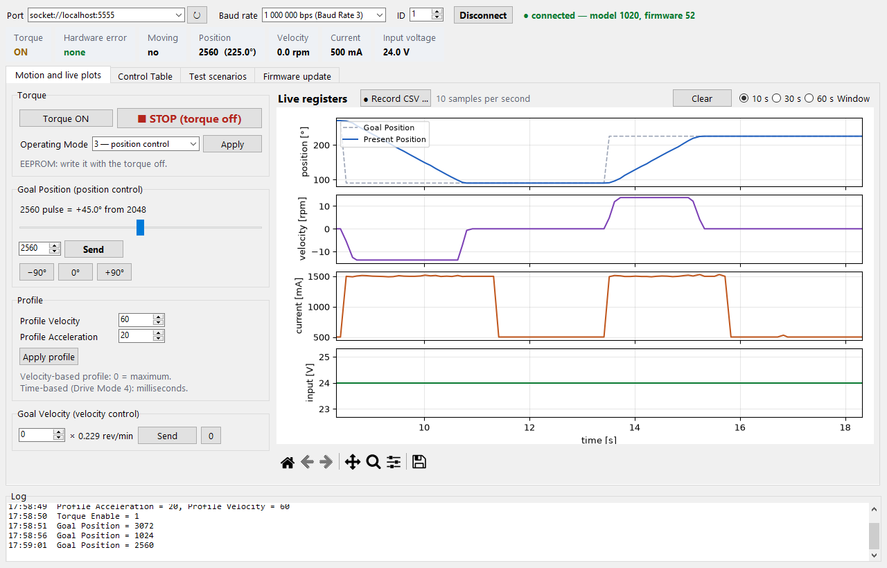
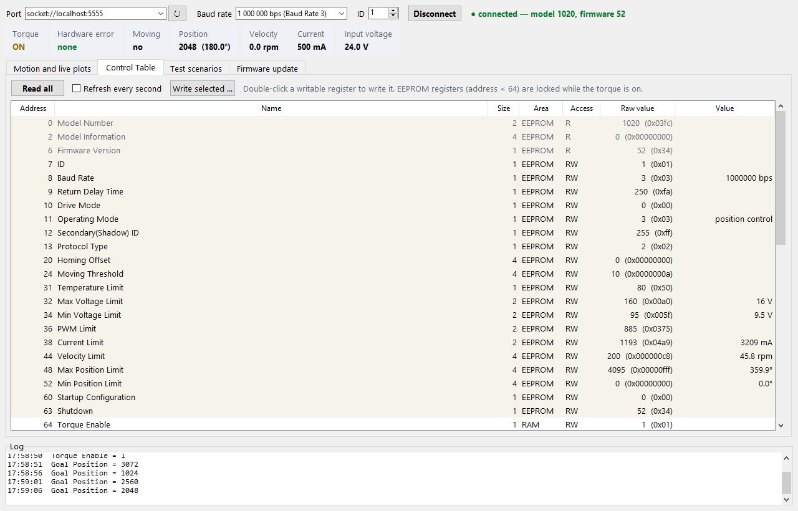
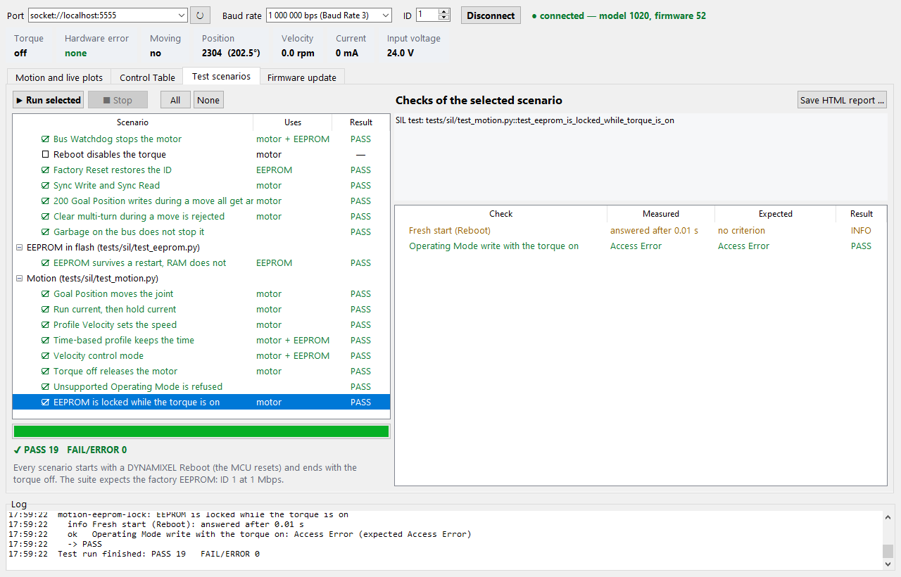
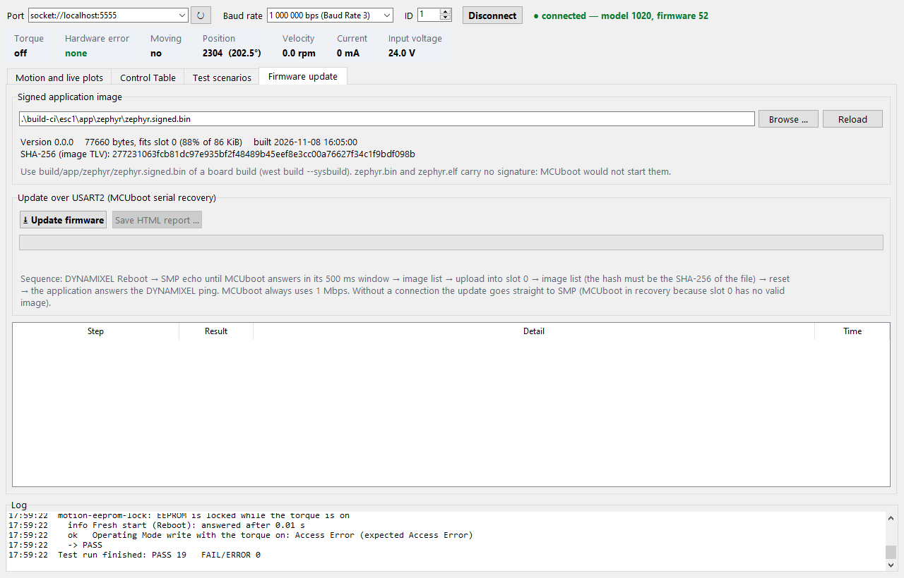

# GUI

The Doppelstep GUI is a desktop program on the host that talks to the B-G431B-ESC1 over the
DYNAMIXEL Protocol 2.0 bus (ST-LINK Virtual COM Port). It is the bench tool for judging the whole
project on the board:

- **Motion and live plots**: torque, Goal Position, profiles, Goal Velocity, live plots of
  position, velocity, current and input voltage, CSV recording.
- **Control Table**: every register of the emulated XM430-W350, read in one block, written by
  double-click.
- **Test scenarios**: the register checks of the SIL tests (`tests/sil`), run on the board, with
  PASS / FAIL per check and an HTML report.
- **Firmware update**: MCUboot serial recovery over the same port, verified by the image hash
  ([Firmware update](../firmware-update.md)).

The screenshots on this page show the GUI connected to the `native_sim` firmware with the
simulated motor (port `socket://localhost:5555`, see
[Simulated motor](../simulation.md#b-on-the-pc)); every value in them comes from the firmware.
On the board, choose the ST-LINK Virtual COM Port instead.

## Starting the GUI

| Platform | VS Code task | Script | Virtual environment |
|---|---|---|---|
| Windows host | **GUI: Run** | `.vscode/host-menu.ps1` | `.venv` |
| Linux desktop | **GUI: Run** | `.vscode/workspace-menu.sh` | `.venv` (`.venv-linux` next to a Windows `.venv`) |

The task creates the virtual environment with `requirements.txt` on first use. It needs Python
3.11 or newer with Tkinter: on Windows the python.org installer ("tcl/tk and IDLE"), on
Debian/Ubuntu the packages `python3-tk` and `python3-venv`. The GUI needs a display, so it runs on
the host and not inside the Dev Container.

By hand:

```powershell
.\.venv\Scripts\python.exe tools\gui\doppelstep_gui.py --port COM5
```

Options: `--port` (preselected port), `--baud` (bps, default 1000000), `--id` (default 1).

## Connecting

Choose the port (the ST-LINK port is preselected when found), the baud rate and the ID, then
**Connect**. The GUI pings the ID and shows the model and firmware version; model 1020 is the
XM430-W350 that Doppelstep emulates. While connected, the bar under the connection shows the live
registers ten times per second: Torque, Hardware error (decoded), Moving, Position, Velocity,
Current and Input voltage.

A changed ID or Baud Rate in the Control Table disconnects; connect again with the new value.

## Motion and live plots

| Control | Register |
|---|---|
| Torque ON / **STOP (torque off)** | Torque Enable (64) |
| Operating Mode: 3 position, 1 velocity (EEPROM: torque off first) | Operating Mode (11) |
| Goal Position: slider, value, −90° / 0° / +90° (2048 = 0°) | Goal Position (116) |
| Profile Velocity, Profile Acceleration | 112, 108 |
| Goal Velocity, ×0.229 rev/min | Goal Velocity (104) |

The plots show Goal and Present Position [°], Present Velocity [rpm], Present Current [mA] and
Present Input Voltage [V] over the last 10, 30 or 60 s, redrawn twice per second. The toolbar under
them zooms and saves a PNG. **Record CSV** writes every sample (10 per second) with the columns
`time_s, goal_position_deg, present_position_deg, present_velocity_rpm, present_current_ma,
input_voltage_v, torque_enable, moving, hardware_error_status, realtime_tick_ms`.



!!! note "Torque Enable refused"
    While `dead-time-ns` is 0 in `app/boards/b_g431b_esc1.overlay` the firmware answers Torque
    Enable with Result Fail and never enables the gate drivers
    ([hardware checklist](../hardware-checklist.md), check 5). The GUI says so when it happens.

!!! warning "No encoder"
    Present Position is the commanded open-loop position. The GUI cannot see lost steps: watch the
    shaft (a mark on it helps).

## Control Table

**Read all** reads every register of the emulated XM430-W350 and shows its address, size, area,
access, raw value and, where the register has a unit, the converted value. **Refresh every
second** repeats the read. Double-click a writable register, or select it and press **Write
selected …**, to write a new value. EEPROM registers (addresses below 64) are locked while the
torque is on, as on the real servo.



## Test scenarios

Each scenario repeats one SIL test with the same writes, waits and limits, on the board instead
of native_sim. A check that needs the log of the motor model (rotor position, lag, model currents)
cannot run on the board and is left out; the scenario lists it under "Not checked on the board".

The suite expects the factory EEPROM: connect to **ID 1 at 1 000 000 bps**. Every scenario starts
with a DYNAMIXEL Reboot (the MCU resets, like a fresh native_sim process for every SIL test) and
ends with the torque off. Scenarios that change the EEPROM put the factory values back. Before the
run the GUI asks for confirmation when the motor turns or the EEPROM changes.

| Scenario | SIL test | Board |
|---|---|---|
| Ping answers as XM430-W350 | `test_boot.py::test_ping_answers_as_xm430_w350` | |
| Live registers at rest | `test_boot.py::test_live_registers_at_rest` | Input voltage recorded, not checked (24.0 V is the model supply) |
| Factory EEPROM | `test_boot.py::test_factory_eeprom` | |
| Bad CRC and other IDs get no answer | `test_bus.py::test_bad_crc_and_other_ids_get_no_answer` | |
| Bus Watchdog stops the motor | `test_bus.py::test_bus_watchdog_stops_the_motor` | model speed left out |
| Reboot disables the torque | `test_bus.py::test_reboot_disables_the_torque_and_keeps_the_position` | Present Position restarts at 2048: Reboot resets the MCU |
| Factory Reset restores the ID | `test_bus.py::test_factory_reset_restores_the_id` | resets **all** EEPROM registers |
| Sync Write and Sync Read | `test_bus.py::test_sync_write_and_sync_read` | |
| 200 Goal Position writes during a move | `test_bus.py::test_rapid_goals_during_a_move_all_get_an_answer` | firmware log left out |
| Clear multi-turn during a move is rejected | `test_bus.py::test_clear_multi_turn_during_a_move_is_rejected` | |
| Garbage on the bus does not stop it | `test_bus.py::test_garbage_on_the_bus_does_not_stop_it` | firmware log left out |
| EEPROM survives a restart, RAM does not | `test_eeprom.py::test_eeprom_survives_a_restart_ram_does_not` | restart = Reboot (MCU reset) |
| Goal Position moves the joint | `test_motion.py::test_goal_position_moves_the_rotor` | model rotor left out |
| Run current, then hold current | `test_motion.py::test_run_then_hold_current` | 1500 / 500 mA ± 40 from Present Current |
| Profile Velocity sets the speed | `test_motion.py::test_profile_velocity_sets_the_speed` | model speed left out |
| Time-based profile keeps the time | `test_motion.py::test_time_based_profile_keeps_the_time` | 1.0 ± 0.15 s from Realtime Tick |
| Velocity control mode | `test_motion.py::test_velocity_mode` | model speed and lag left out |
| Torque off releases the motor | `test_motion.py::test_torque_off_releases_the_motor` | model currents left out |
| Unsupported Operating Mode is refused | `test_motion.py::test_unsupported_operating_mode_is_refused` | |
| EEPROM is locked while the torque is on | `test_motion.py::test_eeprom_is_locked_while_torque_is_on` | |

Not repeated: `test_boot.py::test_startup_log_has_no_error` (reads the firmware log, RTT on the
board) and `test_protection.py` (the faults must be made on the bench).

Results: **PASS** every check met; **FAIL** a check not met or a status error (the first failed
check ends the scenario, as an assert in pytest); **ERROR** the device stopped answering;
**STOPPED** the operator pressed Stop. Select a scenario to see its checks, measured and expected
values and notes. **Save HTML report** writes one self-contained file with the connection, every
scenario and check, and the last firmware update of the session.



## Firmware update

1. Build the board (`west build --sysbuild …`). The tab preselects
   `build/app/zephyr/zephyr.signed.bin` and shows its version, size (slot 0 holds 86 KiB) and the
   SHA-256 TLV. Unsigned files (`zephyr.bin`, `zephyr.elf`) are rejected.
2. Connect as usual, or leave the GUI disconnected when MCUboot already waits in serial recovery
   (no valid image in slot 0, for example after an interrupted upload).
3. **Update firmware** and confirm.



| Step | Passes when |
|---|---|
| Image file | signed MCUboot image with a SHA-256 TLV that fits slot 0 |
| DYNAMIXEL Reboot | sent (skipped when not connected) |
| MCUboot serial recovery | an SMP echo is answered within 3 s, at 1 Mbps |
| Image list before | MCUboot answers (what slot 0 held) |
| Upload | the whole image is written to slot 0 |
| Image check | slot 0 lists the version and the hash of the file |
| Reset | `os reset` sent |
| Application | the application answers the ping within 5 s as model 1020 |

After a passed update the GUI is connected to the new application. **Save HTML report** writes the
steps. If MCUboot does not answer: check that the port is the ST-LINK port, then retry; MCUboot
always uses 1 Mbps, whatever the Baud Rate register says
([troubleshooting](../firmware-update.md#troubleshooting)).

## Structure and tests

| Module (`tools/gui/doppelstep_gui/`) | Role |
|---|---|
| `protocol.py` | Protocol 2.0 packets, CRC, stuffing, status parsing; also used by `tools/sim/dxl2.py` |
| `registers.py` | Control Table of the XM430-W350 (emulator model), units |
| `link.py` | serial port (pyserial); the only module that opens it |
| `device.py` | Protocol 2.0 master with a lock shared by the poller, the panels and the scenarios |
| `poller.py` | live registers, one Read of addresses 64–145 per sample, CSV recording |
| `scenarios.py` | the scenarios and their runner |
| `firmware.py`, `image.py` | update sequence (smpclient), MCUboot image and its hash |
| `report.py` | HTML report |
| `ui/` | Tkinter views, the only modules that import Tkinter and matplotlib |

`tools/gui/tests/` (pytest, host-only, part of `scripts/ci.sh`) checks the protocol, the image
parser, the scenarios against a small fake servo, the update sequence against a fake SMP session,
and that every scenario names an existing SIL test.
