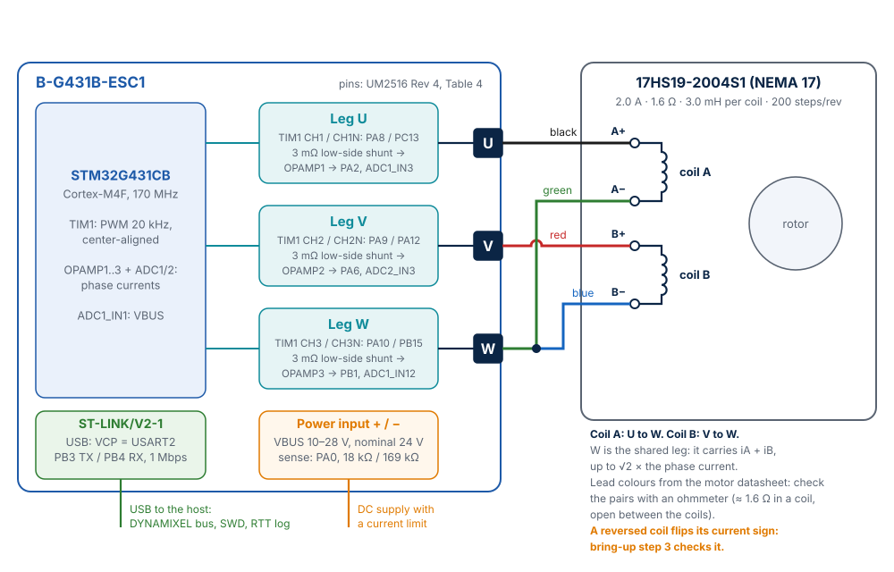

# Hardware and bring-up

Doppelstep runs on the STMicroelectronics **B-G431B-ESC1** Discovery kit, a small
electronic speed controller (ESC) board for drone motors, with a detachable debugger. This page describes
the board, how the stepper motor is wired to it, how the firmware scales the measurements,
and the steps to bring a new setup up safely.

## The board

| Part | Detail |
|---|---|
| Microcontroller | STM32G431CBU6: Arm Cortex-M4F, 170 MHz, 128 KiB flash, 32 KiB SRAM |
| Power stage | L6387 gate drivers, STL180N6F7 MOSFETs, three half-bridges (legs U, V, W) |
| Current sensing | Three 3 mΩ low-side shunts, amplified by the internal OPAMPs of the MCU |
| Debugger | ST-LINK/V2-1 on a detachable part of the board, with a Virtual COM Port |
| Pinout | UM2516 Rev 4, Table 4 (`boards/st/b_g431b_esc1/doc/index.rst`) |

The board definition is part of this repository (`boards/st/b_g431b_esc1/`), because Zephyr
4.5 does not include it: 170 MHz from the 8 MHz crystal, the pinout of the user manual, and
the flash runners OpenOCD (default), J-Link, STM32CubeProgrammer and pyOCD.

## Motor wiring

The board has three half-bridges, while a two-phase stepper has two coils. Doppelstep uses
the **shared-leg topology** of Stepper-C: each coil sits between its own leg and the common
leg W.

| Motor lead (17HS19-2004S1) | Coil end | ESC1 output | Leg pins (TIM1) | Current sense |
|---|---|---|---|---|
| Black | A+ | U | CH1 / CH1N: PA8 / PC13 | OPAMP1 → PA2 (ADC1_IN3) |
| Green | A− | W | CH3 / CH3N: PA10 / PB15 | OPAMP3 → PB1 (ADC1_IN12) |
| Red | B+ | V | CH2 / CH2N: PA9 / PA12 | OPAMP2 → PA6 (ADC2_IN3) |
| Blue | B− | W | CH3 / CH3N: PA10 / PB15 | OPAMP3 → PB1 (ADC1_IN12) |

The lead colours are those of the motor datasheet. Other motors, and some batches, use other
colours: identify the two coils with an ohmmeter before connecting (about 1.6 Ω within a coil,
open between the coils). Swapping the two ends of one coil reverses the sign of its current;
bring-up step 3 checks it.

W carries the sum of both coil currents, iA + iB, up to √2 times the phase current. The
firmware checks the current of every leg, W included, and switches the outputs off when one
exceeds the trip current (`aux-trip` of the motor node). Before the first Torque Enable a
self-test checks each coil at 600 mA: a coil on the wrong legs, an open coil or a short refuses
the torque with a message in the log ([Protection](protection.md)).

The supply goes to the power input pads of the board (+ and −). The firmware accepts
10–28 V (`vbus-min-mv`, `vbus-max-mv`) and is tuned for 24 V; use a laboratory supply with a
current limit for the first runs. The USB cable to the ST-LINK carries the DYNAMIXEL bus, the
debugger and the RTT log.

The tested motor is a **17HS19-2004S1** (NEMA 17, 2.0 A rated, 1.6 Ω and 3.0 mH per coil,
200 steps per revolution). Another motor needs its values in the motor node
([Configuration](configuration.md)).

## Current and voltage scaling

The scaling comes from the power stage node of the devicetree
(`app/boards/b_g431b_esc1.overlay`):

| Quantity | Value |
|---|---|
| Shunt | 3 mΩ |
| Amplifier gain | −64/7 ≈ −9.14 (OPAMP PGA 16 with VINM0 as the bias input, as in ST MCSDK, NuttX and SimpleFOC) |
| Current full scale | ±60.2 A with a 3.3 V reference, about 29 mA per ADC count |
| VBUS divider | 18 kΩ / (18 kΩ + 169 kΩ) |
| VBUS full scale | 34.3 V |
| Temperature | NTC RT1 from 3.3 V to PB14 (ADC1_IN5), R60 4.7 kΩ to ground, C66 10 nF; RT1 = TDK NTCG103JF103FT1, R25 10 kΩ ±1 %, B25/85 3435 K ±1 % |

The bus voltage is measured in every PWM period: Present Input Voltage is the supply of the
bridge. Any supply from 10 V (`vbus-min-mv`, undervoltage trip) to 28 V (`vbus-max-mv`) works;
for the first run with a motor a low one, for example 12 V, limits the damage of a mistake.
The 24.0 V of the simulated-motor build is the bus voltage of the model
(`CONFIG_SFS_SIM_VBUS_MV`), not a measurement. With USB only and no supply, the ADC of the test
board read about 4.7 V on the bus input, below the 10 V undervoltage trip.

The temperature is converted as the fourth injected conversion of every PWM period (about
0.9 µs more before the fast loop) and read with the beta model, about 1309 counts at 25 °C and
3025 at 80 °C. Present Temperature shows it in whole °C. Above Temperature Limit (31, factory
80 °C) the firmware raises Overheating Error, which is in the factory Shutdown mask: the torque
goes off and stays off until a Reboot, as on an XM430. A reading at a rail (NTC open or shorted)
trips the same way, because the stage is then not protected. The simulated-motor build on the
board reads the real NTC; `native_sim` reports a fixed 25 °C.

## Sampling window

The ADC samples the shunts and the bus voltage at the top of the PWM counter, where every
leg is on its low-side switch. A leg with a duty cycle near 100 % leaves that state only
for a moment, and its edges and dead time then fall into the samples. On the board this
happened at the first run with the motor: Torque Enable at 1 A and 1.5 A from a 12 V supply
saturated the current controller for a few milliseconds, one corrupted bus voltage sample
read below 10 V and the undervoltage trip fired (Hardware Error Status 0x01), whatever the
current limit of the supply.

`sample-window-ns` (2400 ns, 408 timer ticks) reserves that time: Stepper-C keeps every
compare value at or below the period minus the window (`sample_window_ticks`) and lowers
its voltage limit by the same 9.6 %, keeping the direction of the voltage vector. Before
the trigger the window covers the dead time (1.2 µs) and about 1 µs of settling, after it
the sampling phases of U, VBUS and W (about 1.5 µs). With it the same Torque Enable at 1.5 A
and moves up to 46 rpm ran without a fault at 12 V.

`current-slew-ma-per-ms` (30 mA/ms) also lets the current rise after Torque Enable instead
of stepping it: 1.5 A in 50 ms, so the supply sees no current step.

## The DYNAMIXEL bus

The bus is **USART2** (PB3 TX, PB4 RX), for now through the ST-LINK Virtual COM Port of the
debugger, at 1 Mbps. A DYNAMIXEL X430-T has no direction pin either: for a TTL half-duplex
bus later, USART2 can run in single-wire mode (`single-wire;` on `&usart2`, TX pin only).
Because USART2 carries the bus, the console and the log use SEGGER RTT through the debug
probe.

## Bring-up checklist

Follow these steps in order on a new board or after a change to the power stage. They follow
the integration guide of Stepper-C.

1. **Dead time (required, measure before the motor).** `dead-time-ns` in
   `app/boards/b_g431b_esc1.overlay` is 1200 ns. The value comes from an ngspice sweep of one
   leg with the gate circuit of schematic MB1419 rev C (L6387ED at 10 V, 33 Ω gate resistors
   without turn-off diode, 1 Ω + 10 nF snubber). [Dead time of the power stage](dead-time.md)
   describes the method step by step, so that it can be repeated:

    | Timer dead time | Result at 24 V, ±3 A, 25 and 100 °C |
    |---|---|
    | 300 to 600 ns | Shoot-through: bus current peaks of 21 to 111 A |
    | 700 to 800 ns | Gates do not overlap, but the Miller bump lifts the off gate to 3.5 V, over VGS(th) |
    | 900 ns | First clean value: bump 2.8 V, bus peak only the Coss and snubber charge |
    | **1200 ns** | 900 ns × 1.3 for the spread of VGS(th), the driver delay mismatch and the fitted MOSFET model |

    Before the first motor run, check it on the board: bench supply at 12 V with a 200 mA
    current limit, no motor, Torque Enable, oscilloscope on the low-side VGS (and on the phase
    node). The gate of the off switch must stay well under VGS(th) at every edge, and the supply
    current must stay small. Lower the dead time (not below 900 ns) only after this measurement.
    With 0 the firmware runs, but never enables the gate drivers: Torque Enable answers Result
    Fail and the log says "enable refused". The gate driver inputs (L6387ED HIN/LIN) are
    active high, as TIM1 CHx/CHxN are configured.
2. **Outputs off.** The RTT log shows the current offsets (about 2048 counts) and the ADC
   readings. Compare Present Input Voltage with a multimeter.
3. **Polarity.** Set `voltage-drive;` and a low `run-current-milliamp` in the motor node.
   After Torque Enable the measured phase A current must be positive. If not, set
   `current-sense-invert;` in the power stage node.
4. **Current loop.** Back to current drive with a low run current: check that the current
   settles at the run current.
5. **Motion.** Small Goal Position steps (DYNAMIXEL Wizard or the [GUI](gui/index.md)), then
   the OpenMANIPULATOR-X profile.
6. **Protection.** Lower `trip-current-milliamp` and `vbus-max-mv`, then check the trips and
   the Hardware Error Status; part E of the [hardware checklist](hardware-checklist.md) checks
   the self-test and the hardware comparators ([Protection](protection.md)).

After a change to the drivers or the threads, also run the
[hardware checklist](hardware-checklist.md): it covers what the PC tests cannot see.
