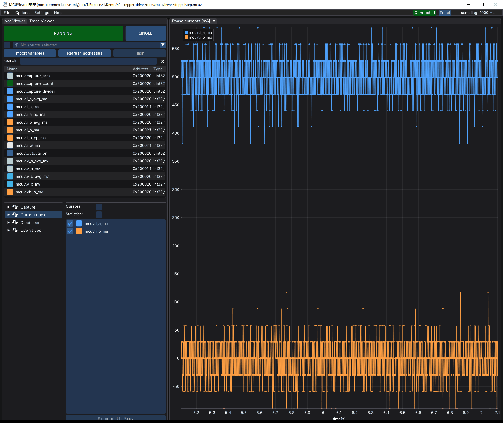
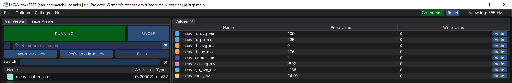

# Measurements with MCUViewer

Two checks on the board need the phase current: the current ripple at rest
([hardware checklist](hardware-checklist.md), check 15) and the effective dead time of the
bridge. Both can be measured without a current probe. The firmware already measures every
phase current in the fast loop and computes every phase voltage. A bench build publishes
these values in RAM, and [MCUViewer](https://mcuviewer.com/) or a script reads them over
the SWD probe while the motor runs.

!!! warning "Bench build only"
    The variables come with the Kconfig option `CONFIG_SSTEP_MOTOR_MCUVIEWER`, off by
    default. A release build never contains them; CI checks this. Turn the option on
    for a measurement and flash a normal build afterwards.

!!! success "Result on the board"
    B-G431B-ESC1 with the 17HS19-2004S1 at 24 V and 12 V, [details below](#results-on-the-b-g431b-esc1).
    **Current ripple at rest:** below the resolution of the measurement. The current at rest
    shows only the noise of the ADC, about one step rms, as large as with the outputs off. No
    toggle at 125 Hz, as the model predicted. **Effective dead time:** 1.05 µs at 24 V,
    1.4 µs at 12 V, the same across the current range at each voltage. **Phase circuit:**
    2.75 Ω at both voltages, more than the coil resistance in the motor data; still open.

## What the measurement can show and what it cannot

| Question | Answer from the firmware |
|---|---|
| Phase currents A, B and the current of the shared leg W | Yes, from the ADC sample of every PWM period (20 kHz) |
| Phase voltage the current loop applies | Yes, from the compare values and the bus voltage |
| Slow ripple of the current loop at rest (check 15) | Yes, down to the noise of the ADC: about one step, 29.4 mA, rms |
| PWM ripple within one period | **No.** The ADC samples once per period, at the top of the counter, so every sample sees the same point of the ripple |
| Effective dead time: the voltage the bridge loses per leg | Yes, from the phase voltage needed at a given current (below) |
| Gate edges, shoot-through, safety margin of the dead time | **No.** That needs an oscilloscope on the gates or the switch node ([bring-up step 1](hardware.md#bring-up-checklist)); the [dead-time sweep](dead-time.md) gives the margin |

## Bench build

```bash
west build -p always --sysbuild -b b_g431b_esc1 -s app -d build-mcuviewer \
    -- -DEXTRA_CONF_FILE=mcuviewer.conf
west flash -d build-mcuviewer
```

[`app/mcuviewer.conf`](https://github.com/SystemFromScratch/sfs-doppelstep/blob/main/app/mcuviewer.conf)
turns on `CONFIG_SSTEP_MOTOR_MCUVIEWER` and sets the capture buffer to 1024 points
(`CONFIG_SSTEP_MOTOR_MCUVIEWER_SAMPLES`, 8 bytes each). The log at startup shows
`MCUViewer variables on (bench build)`. The build needs about 8 KB more RAM: 27.5 KB of
32 KB. On the board, the fast loop of the bench build took at most 15.4 µs of the 50 µs
period (largest value since the last statistics read), with no overrun in 23 million
periods.

## MCUViewer

[`tools/mcuviewer/doppelstep.mcuv`](https://github.com/SystemFromScratch/sfs-doppelstep/blob/main/tools/mcuviewer/doppelstep.mcuv)
is a ready MCUViewer project (MCUViewer 1.4). It takes the ELF file from
`build-mcuviewer/app/zephyr/zephyr.elf`, relative to the project. Open it with
**File → Open project**, select the probe, and start the acquisition. The motor keeps
running: MCUViewer reads the RAM without stopping the CPU.

| Group | Plots | Use |
|---|---|---|
| Current ripple | Phase currents of every sample | Check 15 at rest |
| Dead time | Averaged currents, averaged phase voltages, phase A voltage over current (XY) | Slow move |
| Live values | Table: averages, peak-to-peak currents, bus voltage | Numbers at a glance |
| Capture | Table: `capture_arm`, `capture_divider`, `capture_count` | Start a capture from MCUViewer |

Probe settings that worked with the on-board ST-LINK/V2-1:

- **Mode normal.** In the HSS (high-speed sampling) mode MCUViewer did not connect to this
  probe.
- **Keep connection off** when `mcuv.py` should use the probe too. With keep connection on,
  MCUViewer holds the ST-LINK after Stop, and pyOCD waits for it.

SWO is not available on this board: PB3 is the TX pin of the DYNAMIXEL bus. MCUViewer
therefore polls the RAM. With the ST-LINK/V2-1 this gave 1000 samples per second with two
variables in the group, 555 with eight and about 435 with ten. That is enough for the live
values and the averages. For the fast loop at the full 20 kHz, use the capture buffer.

| Variable | Unit | Meaning |
|---|---|---|
| `mcuv.i_a_ma`, `mcuv.i_b_ma` | mA | Measured phase currents, last period |
| `mcuv.i_w_ma` | mA | Measured current of the shared leg W (Kirchhoff: about −(A + B)) |
| `mcuv.v_a_mv`, `mcuv.v_b_mv` | mV | Phase voltage the current loop applied in the sampled period; 0 with the outputs off |
| `mcuv.vbus_mv` | mV | Bus voltage |
| `mcuv.i_a_avg_ma` … `mcuv.v_b_avg_mv` | mA, mV | The four values above, averaged over 256 periods (12.8 ms) |
| `mcuv.i_a_pp_ma`, `mcuv.i_b_pp_ma` | mA | Peak-to-peak current over the last 100 ms |
| `mcuv.outputs_on` | | 1 while the bridge switches |
| `mcuv.periods` | | Fast-loop periods; rises by 20 000 per second |
| `mcuv.capture_arm`, `capture_divider`, `capture_count` | | Capture buffer `mcuv_buf`, see below |

## Capture buffer

Writing `mcuv.capture_arm = 1` makes the fast loop record the phase currents and voltages
of every `capture_divider`-th period into `mcuv_buf`. When the buffer is full the firmware
sets `capture_arm` back to 0. The Capture group of the MCUViewer project writes it from
its table. `tools/mcuviewer/mcuv.py` does the same over the probe, saves a CSV file and
evaluates it. It needs pyOCD (`pip install pyocd`).

```bash
python tools/mcuviewer/mcuv.py capture --elf build-mcuviewer/app/zephyr/zephyr.elf \
    --divider 1 --out rest.csv
```

| `--divider` | Rate | 1024 points cover |
|---|---|---|
| 1 | 20 kHz | 51 ms: ripple at rest |
| 4 | 5 kHz | 205 ms: ripple at rest, 4.9 Hz resolution |
| 30 | 667 Hz | 1.5 s: a slow move for the dead time |

## Current ripple at rest (check 15)

1. Torque Enable, move to a position, wait for the hold current (0.5 A after 500 ms).
2. Look at the Current ripple group, or read `mcuv.i_a_pp_ma` and `mcuv.i_b_pp_ma`.
3. Capture at 20 kHz and evaluate:

```bash
python tools/mcuviewer/mcuv.py capture --elf build-mcuviewer/app/zephyr/zephyr.elf --divider 1 --out rest-0.csv
python tools/mcuviewer/mcuv.py ripple rest-0.csv
```

```text
1024 points, 51.2 ms at 20000 Hz
phase A: mean    499.4 mA  min    381  max    587  p-p   206 mA  rms   31.7 mA  largest line  2656.2 Hz,    5.6 mA
phase B: mean     -0.3 mA  min    -89  max    117  p-p   206 mA  rms   30.3 mA  largest line  3691.4 Hz,    5.7 mA
```

4. Repeat at several rotor positions: one with the current in one coil only (full step),
   one between full steps (both coils), and a few in between.
5. Capture once with the torque off. The noise of the ADC alone gives the floor: a ripple
   at rest that is not larger than this floor is below the resolution.



The model predicted a toggle by one ADC step, 29.4 mA peak-to-peak, around 125 Hz. The
largest line of a 5 kHz capture would show it. Check 16, vibration and noise at the same
positions, is still done by ear or with a vibration sensor.

## Effective dead time

During the dead time both switches of a leg are off. The current then flows through a
body diode, and the leg voltage follows the direction of the current instead of the
PWM. Every leg loses on average

```text
Vd = Vbus * td_eff * f_pwm
```

against the direction of its current: 24 V × 1.2 µs × 20 kHz = **0.58 V** for the set
dead time. The current loop makes up for the loss, so the phase voltage it applies is

```text
vA = R * iA + Vd * (sign(iA) + sign(iA + iB)) + cA        (vB likewise)
```

Phase A is U − W. Its current leaves leg U with iA and leg W with −(iA + iB), so it sees
the loss of both legs. A slow move runs through all signs and current levels. A
least-squares fit to both phases then gives the phase resistance R, the loss Vd and small
offsets cA and cB. The effective dead time is

```text
td_eff = Vd / (Vbus * f_pwm)
```

It differs from the set 1200 ns: switching delays of the driver and the MOSFETs add to
it or take from it, and at small currents the snubber and Coss move the switch node before
the dead time ends. Currents under 150 mA are therefore left out of the fit (`--min-ma`).

1. Torque Enable, Profile Velocity 5 (about 1.1 rpm: one electrical period, 4 full steps,
   per second), a Goal Position far enough for the move to last a few seconds; on the board
   400 units (35°) took about 5 s.
2. During the move, capture at 667 Hz and evaluate. Several captures at the same bus
   voltage can be evaluated together:

```bash
python tools/mcuviewer/mcuv.py capture --elf build-mcuviewer/app/zephyr/zephyr.elf --divider 30 --out slow-1.csv
python tools/mcuviewer/mcuv.py deadtime slow-1.csv slow-2.csv
```

```text
3605 phase samples with |i| >= 150 mA (+1803 / -1802), Vbus 24.02 V, PWM 20000 Hz
R phase          2.785 Ohm   (fitted: coil, cables, MOSFETs, shunt)
Vd per leg         502 mV
offset A / B      -182 / -294 mV
residual rms       657 mV
effective dead time   1046 ns   (set: 1200 ns)

|i| range [mA]   samples   Vd per leg [mV]   dead time [ns]   (R = 2.785 Ohm)
     0 .. 250          75             410              854
   250 .. 500         223             485             1009
   500 .. 750         252             524             1091
   750 .. 1000        289             512             1065
  1000 .. 1250        496             494             1029
  1250 .. 1500       1377             509             1059
  1500 .. 1750        130             485             1010
```

3. Check the table: the loss of a dead time is the same at every current above a few
   hundred mA. A loss that grows with the current means that R is wrong. Measure the
   phase resistance with an ohmmeter and give it with `--r-ohm`.
4. Repeat at 12 V. The effective dead time and R should not change with the bus voltage,
   while Vd halves.


The XY plot shows the dead time directly. Without it, the phase A voltage over the
current would be the straight line R × iA. The loop comes from the loss of leg W, which
changes its sign with iA + iB, 45 electrical degrees away from the zero of iA. At this
speed, back-EMF and inductive voltage are about 30 mV each, much less than the width of
the loop.

The residual of 657 mV is the noise of the commanded voltage. The current loop answers
the noise of the ADC, which gives about 570 mV rms at rest as well. It does not bias the
fit: 3600 samples average it down to about 11 mV.

## Results on the B-G431B-ESC1

Bench build on the board of the [test record](test-record.md), 17HS19-2004S1, 24 V and
12 V, hold current 0.5 A, run current 1.5 A.



### Current at rest

Captures of 51 ms at 20 kHz, positions in Present Position units (4096 per turn, 20.48 per
full step), from 2048, a full step with the current in phase A:

| Position | Phase A mean | Phase B mean | p-p A / B | rms A / B | Largest line |
|---|---|---|---|---|---|
| +0 (full step) | 499.4 mA | −0.3 mA | 206 / 206 mA | 31.7 / 30.3 mA | 5.6 mA |
| +5 | 461.3 mA | 190.7 mA | 177 / 235 mA | 31.4 / 32.1 mA | 6.1 mA |
| +10 (half step) | 353.2 mA | 353.3 mA | 235 / 265 mA | 30.3 / 30.2 mA | 5.4 mA |
| +15 | 190.8 mA | 461.4 mA | 205 / 235 mA | 32.9 / 31.0 mA | 7.0 mA |
| +20 (next full step) | −0.4 mA | 499.4 mA | 177 / 205 mA | 30.6 / 31.6 mA | 4.7 mA |
| Torque off | 67.8 mA | 119.2 mA | 206 / 205 mA | 30.8 / 28.2 mA | 8.2 mA |

- The mean currents follow the sine of the microstep exactly: 353 mA at the half step
  is 0.5 A × cos 45°.
- The noise is the same with the torque on and off: about one ADC step rms, peaks of
  −4 to +3 steps. The ripple of the real coil current is below the resolution of the
  measurement. A 205 ms capture at 5 kHz (4.9 Hz resolution) shows no line above 6 mA,
  so no toggle at 125 Hz.
- With the torque off, the mean read 68 and 119 mA half a second after the disable, then
  9 to 36 mA after a minute: less than one ADC step.
- At 12 V the current at rest at the full step is the same: 499.2 mA, 30.6 mA rms, largest
  line 5.4 mA.

### Effective dead time

Two slow moves at Profile Velocity 5, 400 units each way, captured at 667 Hz, at each bus
voltage:

| Fit | R phase | Vd per leg | Effective dead time | Residual |
|---|---|---|---|---|
| 24 V, move 1 | 2.797 Ω | 484 mV | 1007 ns | 625 mV |
| 24 V, move 2 | 2.814 Ω | 502 mV | 1044 ns | 679 mV |
| 24 V, both, R fitted | 2.785 Ω | 502 mV | 1046 ns, 1010 to 1091 ns above 250 mA | 657 mV |
| 24 V, both, R = 1.7 Ω given | 1.7 Ω | 1116 mV | 1088 ns at 0.1 A, rising to 2740 ns at 1.6 A | 818 mV |
| 12 V, move 1 | 2.702 Ω | 362 mV | 1513 ns | |
| 12 V, move 2 | 2.808 Ω | 300 mV | 1253 ns | |
| 12 V, both, R fitted | 2.739 Ω | 335 mV | 1403 ns, 1335 to 1461 ns from 250 to 1500 mA | 652 mV |
| 12 V, both, R = 1.7 Ω given | 1.7 Ω | 923 mV | 3860 ns | 802 mV |

**Resistance of the phase circuit.** With R fitted, the loss is the same above 250 mA,
as a dead time should be. With the coil resistance of the motor data, the dead time would
have to grow with the current, and the model fits worse. The fit gives 2.79 Ω at 24 V and
2.74 Ω at 12 V: the extra resistance does not depend on the bus voltage, so it is a real
resistance in the loop, about 1.1 Ω more than the motor data. The current scaling of the
firmware is the usual one for this board (3 mΩ shunt, gain 16 × 4/7 = 9.14). Open point:
measure the coils with an ohmmeter at the motor connector and at the board terminals, and
the current at rest at a full step (0.5 A DC in one coil) with a multimeter in series. That
tells a resistance in the wiring from an error of the current measurement.

**Effective dead time.** About **1.05 µs** at 24 V (0.50 V per leg, a phase loses up to
1 V, about 4 % of the bus voltage) and about **1.4 µs** at 12 V (0.34 V per leg). A
constant dead time would give the same time at both voltages. The loss is therefore not
proportional to the bus voltage alone; a straight line through both points gives
`Vd = Vbus × f_pwm × 0.69 µs + 0.17 V`. The two moves at 12 V differ by 260 ns, so this
split is only a first estimate. A likely cause is the switching edge itself: the snubber of
each leg (1 Ω + 10 nF) and Coss have to be charged by the phase current within the dead
time, which takes C × Vbus / I, about 240 ns at 1 A and 24 V.
