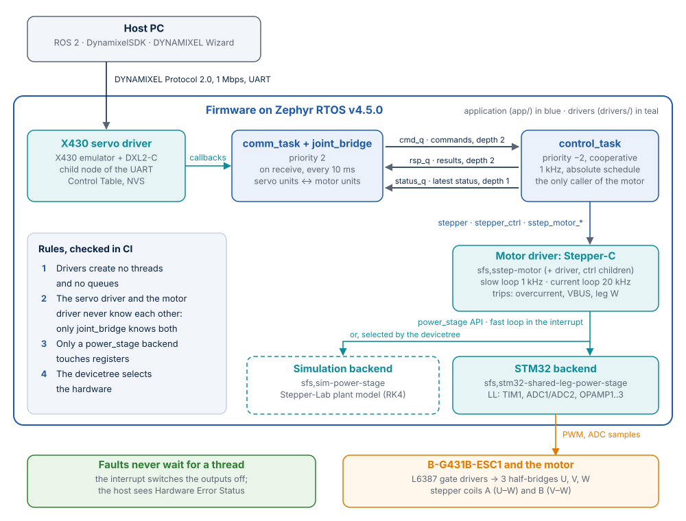

# Introduction

Doppelstep is open-source firmware that makes an ordinary stepper motor behave like a smart
servo. It runs on a small motor-control board from STMicroelectronics, the
**B-G431B-ESC1**, drives a two-phase stepper motor with precise current control, and answers
on its serial bus exactly like a **DYNAMIXEL XM430-W350** servo. Software written for that
servo, such as the ROS 2 driver of the OpenMANIPULATOR-X robot arm, works with it unchanged.

This page explains the idea in plain words, who the project is for, what it does and does
not do, and the terms used in the rest of the documentation.

## The idea in plain words

A **smart servo** is a motor with its own electronics. A robot controller sends it short
messages over a cable ("go to 90 degrees at this speed", "how much current do you use?"),
and the servo does the rest. A **stepper motor** is simpler and cheaper and holds its
position firmly, but it understands no messages: it needs electronics that feed its two
coils with carefully shaped currents, thousands of times per second.

Doppelstep is that electronics' firmware. It does two jobs at once:

| Job | How |
|---|---|
| **Speak like the servo** | It receives and answers DYNAMIXEL Protocol 2.0 messages and keeps the same table of settings and readings (the *Control Table*) that a real XM430-W350 keeps |
| **Drive the motor** | It turns each command into a smooth motion profile and controls the two coil currents 20 000 times per second, in steps 16 times finer than the motor's own 200 steps per revolution |

The controller on the other end of the cable cannot tell the difference. That is where the
name comes from: Doppelstep is the *double* (German *Doppelgänger*) of a servo
([Naming](NAMING.md)).

## The chain, from the robot controller to the motor

| Stage | What happens | Where in the documentation |
|---|---|---|
| Host PC | ROS 2, DynamixelSDK or DYNAMIXEL Wizard sends Protocol 2.0 packets at 1 Mbps | [DYNAMIXEL emulation](dynamixel.md) |
| Serial bus | USART2 of the board (for now through the USB port of the on-board debugger) | [Hardware and bring-up](hardware.md) |
| Servo emulator | Checks every packet and every register access as the real servo does | [Architecture](architecture.md) |
| Application | Converts servo units into motor commands and back, in separate threads for the bus and for control | [Architecture](architecture.md#a-command-from-the-bus-to-the-motor) |
| Motor control | Stepper-C plans the motion at 1 kHz and controls the coil currents at 20 kHz | [Technology stack](technology.md#motor-control) |
| Power stage | A timer switches three half-bridges; the ADCs measure the currents and the supply voltage | [Hardware and bring-up](hardware.md) |
| Motor | A NEMA 17 stepper, wired with one shared leg for both coils | [Hardware and bring-up](hardware.md#motor-wiring) |

## Who it is for

| You are… | Doppelstep gives you |
|---|---|
| A robotics developer using ROS 2 | A low-cost joint that your existing DYNAMIXEL software already knows how to drive |
| An embedded engineer | A complete, documented Zephyr RTOS firmware to study or build on: drivers, devicetree, threads, bootloader, tests |
| A team evaluating a supplier | A real product, not a demo: measured figures, tests on every change, honest limits |
| A student or maker | A project you can run on your PC in minutes, without any hardware, and then on an off-the-shelf evaluation board |

## What it does, and what it does not do

| Doppelstep… | Why |
|---|---|
| **Does** emulate one XM430-W350 on the bus, in position, extended position and velocity mode | These are the modes the OpenMANIPULATOR-X and most ROS 2 setups use |
| **Does** control the coil currents in closed loop, with microstepping | Smooth, quiet motion and a defined torque, instead of switching full voltage onto the coils |
| **Does** protect the hardware inside the 20 kHz interrupt | A fault must switch the outputs off within one control period, whatever the threads are doing |
| **Does** run unchanged on a PC with a simulated motor | Protocol, motion and protection can be tested on every change, without risking hardware |
| **Does** update its own firmware over the servo bus | Only the bus cable is needed in the field; a signature check rejects foreign images |
| **Does not** measure the rotor position | The motor has no encoder. Reported positions are the commanded ones, and a lost step is not detected yet ([Status](#status-and-known-limits)) |
| **Does not** support current-based and PWM modes of the servo (Operating Modes 0, 5, 16) | Without a position sensor they would not behave like the real servo; the firmware refuses them as the servo refuses invalid values |
| **Does not** share a bus with real DYNAMIXEL servos yet | The bus runs through the debugger's USB port for now; a TTL half-duplex bus is planned |

## Key properties

Measured on this version with the CI build (`scripts/ci.sh`), unless noted.

| Property | Value |
|---|---|
| Microcontroller | STM32G431CB: Arm Cortex-M4F, 170 MHz, 128 KiB flash, 32 KiB RAM |
| RTOS | Zephyr RTOS v4.5.0, with sysbuild and MCUboot |
| Application size | 77 356 B flash of the 87 712 B slot, 19 032 B RAM |
| Bootloader size | MCUboot, 37 148 B flash of its 38 KiB partition |
| Control rates | Current loop 20 kHz (PWM rate), motion loop 1 kHz, bus status every 10 ms |
| Motor resolution | 3200 microsteps per revolution (200 steps × 16) |
| Bus | DYNAMIXEL Protocol 2.0, 1 Mbps (factory value), XM430-W350, model number 1020 |
| Automated tests | 55 ztest cases in 4 suites, 28 SIL and integration tests, 8 motion tests on the fixed-point backend: 91 per CI run |
| Toolchain | Zephyr SDK 1.0.1 in a pinned Docker image |
| License | Apache License 2.0 |

## Status and known limits

Doppelstep is under active development. These items are open, and the documentation says so
wherever they matter:

- **Dead time.** `dead-time-ns` in `app/boards/b_g431b_esc1.overlay` is 0 until the value of
  the board's motor-control reference project is entered. With 0 the firmware runs but never
  switches the power stage on ([bring-up step 1](hardware.md#bring-up-checklist)).
- **Lost steps are not reported.** A load above the holding torque makes the motor lose
  synchronism silently. A test documents this as an expected failure
  ([Tests](testing.md#expected-failure-lost-synchronism)).
- **The driver refactor is not yet checked on the board.** The checks to run are listed in
  the [hardware checklist](hardware-checklist.md).
- **Rotor vibration at rest in the model:** one ADC step in the current loop excites the
  mechanical resonance (up to about 3 rpm, 0.2 microstep). Not yet measured on a real motor.
- **Fast-loop execution time** on the target is not measured yet; the log of the simulated
  motor on the board shows the longest fast-loop callback.
- **Temperature:** the NTC sensor is not converted yet. Present Temperature keeps its table
  value and there is no overheating trip.
- **Bus:** a single-wire TTL bus instead of the debugger's serial port, and a shared bus with
  real DYNAMIXEL servos, are planned.

## Terms used in this documentation

| Term | Meaning |
|---|---|
| **Stepper motor** | A motor that turns in fixed steps (here 200 per revolution) when its two coils are energised in sequence |
| **Microstepping** | Shaping the two coil currents as sine and cosine, so the rotor stops between the full steps (here 16 microsteps per step) |
| **Closed-loop current control** | Measuring the coil currents and correcting the voltage every PWM period, so the current follows its set value |
| **Smart servo** | A motor with built-in control electronics that takes position or velocity commands over a bus |
| **DYNAMIXEL, Protocol 2.0** | A family of smart servos by ROBOTIS and the packet protocol they speak |
| **Control Table** | The numbered registers of a DYNAMIXEL servo: settings (EEPROM area, kept after power off) and live values (RAM area) |
| **Zephyr RTOS** | An open-source real-time operating system for microcontrollers, hosted by the Linux Foundation |
| **Devicetree, Kconfig** | Zephyr's two configuration languages: the devicetree describes the hardware, Kconfig selects the software features |
| **Power stage, half-bridge** | The transistors that switch the supply voltage onto the motor coils; a half-bridge is one pair of them |
| **Fast loop, slow loop** | The current controller in the PWM interrupt (20 kHz) and the motion planner in a thread (1 kHz) |
| **MCUboot** | An open-source secure bootloader: it starts only firmware with a valid signature |
| **SIL (software in the loop)** | Testing the real firmware against a simulated motor instead of the real one |
| **native_sim** | A Zephyr target that builds the firmware as a normal Linux program |
| **ROS 2, ros2_control** | The Robot Operating System and its framework for hardware drivers of robot joints |
