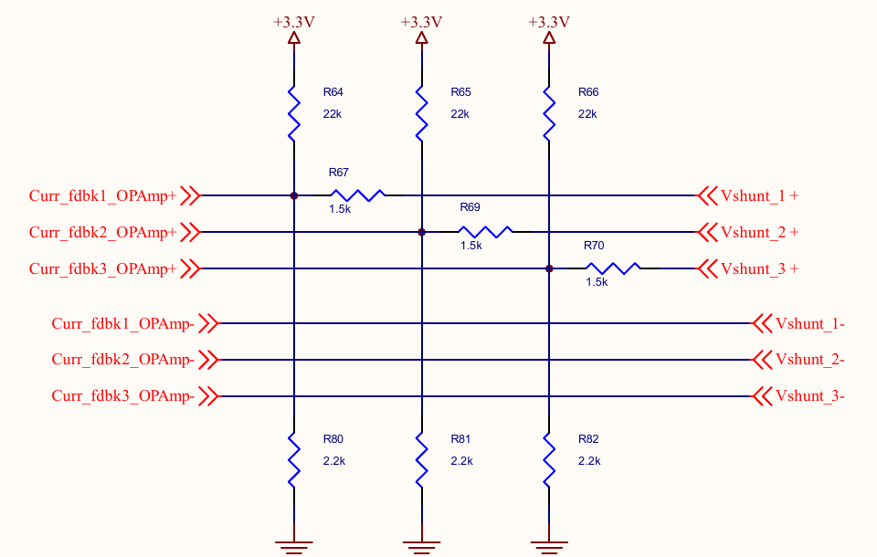

# Protection

Doppelstep protects the power stage and the motor in layers, from comparators that switch the
gates off in hardware to checks before the torque comes on. Each layer covers what the one
above cannot see or cannot do fast enough. This page lists them, with what each one detects,
how fast it acts, what it does and how the host sees it.

The values are those of the B-G431B-ESC1 with the 17HS19-2004S1
(`app/boards/b_g431b_esc1.overlay`).

## Overview

| Layer | Detects | Reaction time | Reaction | Hardware Error Status |
|---|---|---|---|---|
| Hardware comparators (STM32 backend) | Leg current above 10 A in a low-side switch; bus above 30 V | Break filter, about 0.5 µs | TIM1 break: gates off without software, latched until reset | Electrical Shock (0x10); Input Voltage (0x01) |
| Leg trip (STM32 backend, interrupt) | \|iU\|, \|iV\| or \|iW\| above 3.5 A, in current and voltage drive | Next PWM period, at most 50 µs | Outputs off, fault latched | Electrical Shock (0x10) |
| Fast-loop overrun (STM32 backend) | The fast loop did not finish within its period | One period | Outputs off in the interrupt, fault latched | Electrical Shock (0x10) |
| Stepper-C fast loop | Phase current or the current of the shared leg (\|iA + iB\|) above 3.5 A (current drive); bus below 10 V or above 28 V | Same period | Outputs off, fault latched | Electrical Shock (0x10); Input Voltage (0x01) |
| Stepper-C stall detection | The rotor does not follow the commanded angle | `stall_time_ms` | Outputs off, fault latched | Not enabled in Doppelstep |
| Current offset check (calibration at start) | An offset outside 2300..2800 counts | Once, at start | Outputs refused for good, the bus keeps running | Electrical Shock (0x10) |
| Bus voltage check (Torque Enable, Stepper-C) | Bus outside 10..28 V | Before anything is energised | Torque Enable answers Result Fail, nothing latched | Input Voltage (0x01) |
| Self-test (first Torque Enable, Stepper-C and the motor driver) | Open coil, short, wrong polarity, coil on the wrong legs, broken current sensing, a leaking switch | About 15 to 60 ms, before the motor runs | Torque Enable answers Result Fail, fault latched | Electrical Shock (0x10) |
| Temperature (application) | NTC above Temperature Limit (80 °C), or the NTC open or shorted | With the live registers | Torque off until a Reboot (factory Shutdown mask) | Overheating (0x04) |
| Watchdog (application) | A task stops checking in | 500 ms | MCU reset: the outputs start off | None (the reset cause is logged) |

A latched fault keeps the outputs off: Torque Enable answers Result Fail until a DYNAMIXEL
Reboot (an MCU reset on the board) clears it, as on an XM430.

## Hardware trips

The software layers react at the PWM rate at best: 50 µs. A short through a switch reaches
tens of amperes in a few microseconds, so the STM32 backend adds comparators that act without
software.

### Where the comparators look

The current amplifiers of the board are the internal OPAMPs of the MCU. Their non-inverting
inputs (PA1, PA7, PB0) carry the shunt voltage on a bias set by the board:



The node is a divider of three conductances, 1/22 kΩ to 3.3 V, 1/2.2 kΩ to ground and
1/1.5 kΩ to the shunt:

```text
V+ = 3.3 V × (1/22k) / (1/22k + 1/2.2k + 1/1.5k) + Vshunt × (1/1.5k) / (1/22k + 1/2.2k + 1/1.5k)
   = 0.129 V + 4/7 × Vshunt
```

With the PGA gain of 16 this gives the −64/7 of the overlay, and the offsets measured on the
board, about 2530 counts, are 16 × 0.129 V. One ampere through a 3 mΩ shunt moves V+ by
4/7 × 3 mV = 1.71 mV.

COMP1, COMP2 and COMP4 compare PA1, PA7 and PB0 with DAC3. The DAC level is computed after the
offset calibration from the measured offset: `(offset + trip counts) / 16`, so the spread of
the bias resistors and of the 3.3 V cancels. At 10 A and an offset of 2534 counts the level is
DAC code 180 (0.145 V). COMP3 compares the bus divider on PA0 with DAC1: 30 V is code 3583.

COMP1/2/4 drive the break input BRK of TIM1 and COMP3 drives BRK2, so the firmware can tell
the overcurrent from the overvoltage. The break clears MOE: every gate driver input goes low,
both switches of every leg are off. The interrupt then reports the trip
(`POWER_STAGE_TRIP_HW_OC` or `_HW_OV`) to the motor driver, which latches the fault. The backend
refuses its outputs after a break until the next reset.

### What they catch, and what not

A current down through a low-side switch makes the shunt voltage positive: shoot-through, a
phase shorted to the bus, a short between two phases while one of them is on its low side. The
comparators catch all of these.

!!! warning "Limits"
    - **A phase shorted to ground while its high side conducts** does not pass any shunt. Only
      the undervoltage trip (if the supply collapses) and the current limit of the supply act.
      Use a laboratory supply with a current limit for the first runs.
    - **Comparator offset:** up to ±5 mV in the datasheet, ±3 A at the trip level. 10 A stays
      well above the 3.5 A software trip and far below what the MOSFETs and shunts take. A
      setting near the bias does not work: 1 A tripped at rest on the test board.
    - **Break filter:** 0.47 µs (fDTS / 16, N = 5) rejects switching spikes: no false break in
      2 minutes of 180° moves at 46 rpm and 1.5 A on the test board.

**Measured on the test board** (outputs off, DAC3 swept with the debugger): COMP1 (U) and
COMP2 (V) switch at DAC code 159, COMP4 (W) at 161, while the ADC offsets give 158.4 and
157.9. With the level of 10 A (code 180) the break therefore acts at about 9.9 A on U and V
and 8.9 A on W. The overvoltage path was checked with a level of 11 V on a 12 V supply:
Input Voltage Error right after the start, Torque Enable refused.

The simulated-motor build on the board leaves the comparators out (`app/sim.overlay`): its
outputs stay off, and the image has no flash to spare.

## Software trips

**Leg trip.** The STM32 interrupt checks the current of every leg against the trip current of
the motor node (`trip-current-milliamp`, 3.5 A) in every PWM period. Stepper-C checks the two
phase currents itself, but only in current drive; the leg trip also covers voltage drive
(bring-up step 3, `voltage-drive;`) and the shared leg W, which carries iA + iB, up to √2 times
the phase current. It is active only after a successful offset calibration: with an unknown
offset a false trip would latch at every start.

**Fast-loop overrun.** When the next measurement is ready before the fast loop returns, the
interrupt switches the outputs off at once and reports the overrun with the next sample
([Architecture](architecture.md)).

**Stepper-C** (fast loop, every 50 µs) trips on the phase currents and on the current of the
shared leg, \|iA + iB\|, in current drive, and on the bus voltage below `vbus-min-mv` (10 V) or above `vbus-max-mv` (28 V). Each check uses one sample, so the samples must be clean: the
[sampling window](hardware.md#sampling-window) keeps every switching edge out of them. Its stall detection
(`stall_time_ms`) is off in Doppelstep: the motor node has no stall properties yet.

## Checks before the torque comes on

**Current offsets.** At start, with the outputs off, the backend measures the zero of every
current amplifier. An offset outside `current-offset-min-counts`..`current-offset-max-counts`
(2300..2800) means a broken amplifier, shunt or bias network. The stage then refuses its
outputs; the bus keeps running and Hardware Error Status shows Electrical Shock, so the host
sees the fault instead of a silent board. The RTT log names the offsets.

**Bus voltage.** Torque Enable with the bus outside 10..28 V answers Result Fail and raises
Input Voltage Error before anything is energised: `sstep_enable()` and `sstep_selftest()` of
Stepper-C check the last sample and answer `SSTEP_ERR_VBUS`, which the motor driver returns as
`-ERANGE`. Nothing is latched: once
the supply is in range, Torque Enable works (Hardware Error Status keeps the bit until a
Reboot, as on an XM430). With only the USB cable connected the bus reads about 4.7 V.

### Self-test of the bridge and the motor

At the first Torque Enable after start or Reboot, the motor driver runs the self-test of
Stepper-C, `sstep_selftest()`, before the motor is enabled (`CONFIG_SSTEP_MOTOR_SELFTEST`, which
selects `CONFIG_SSTEP_SELFTEST`, the library option `SSTEP_CFG_SELFTEST`). The fast loop of the
library runs it, one step per PWM period:

1. **All legs low, 2 ms.** No phase may carry current. A current here means a high-side switch
   that conducts.
2. **Coil A.** W and V stay low, the duty of U rises slowly until the phase A current reaches
   the test current (`selftest-current-milliamp`, 600 mA), then holds it for 2 ms.
3. **Coil B.** The same with V.

Stepper-C sees the two phase currents only. Meanwhile the motor driver adds up the three leg
currents of every sample, iU + iV + iW, filtered over 8 periods: above a quarter of the test
current the shunt or the amplifier of a leg is broken, and the test fails although Stepper-C
passed it. The algorithm and its limits are in the
[Protection chapter of Stepper-C](https://antonvynohradov.github.io/Stepper-C/protection/).

The voltage is ramped instead of set from the coil resistance: at 12 V the dead time of 1.2 µs
eats about 0.58 V of the coil voltage, as much as the 0.96 V that 600 mA needs through 1.6 Ω.
The levels of the checks include that loss.

| Log message | Likely cause |
|---|---|
| `no current (phase open, motor not connected or leg dead)` | Coil wire loose or not connected, motor unplugged, a switch or gate driver of the leg dead |
| `current too high (short circuit)` | Coil or phases shorted (the current came before the voltage could drive it through 1.6 Ω), or a trip during the test |
| `current of the wrong sign (current-sense-invert)` | The current sensing has the opposite sign: set or clear `current-sense-invert;` in the power stage node |
| `current in the other phase (phase on the wrong legs)` | A coil is connected to U and V instead of U and W (or V and W): check the [wiring](hardware.md#motor-wiring) |
| `iU + iV + iW is not 0 (a current sensor is broken)` | Amplifier or shunt of a leg broken; the three leg currents must add up to zero |
| `current with all legs low (a switch conducts)` | A high-side switch conducts with its gate off |
| `aborted by a bus voltage trip or a power stage error` | The supply collapsed during the test (current limit too low) or the stage refused a command |
| `timeout` | The test did not end within 100 ms: the fast loop does not run |

The log line also gives the coil, the measured current, the current of the other phase and
the duty. On the board without a motor, at 12 V:

```text
<err> sstep_motor: selftest: no current (coil open, motor not connected or leg dead), coil A, 2 counts (test -20, other phase 0) at duty 1221/1220
```

A failed test
latches the fault: Torque Enable answers Result Fail until a Reboot, so the test does not
drive a broken bridge again and again.

During the test the rotor moves to the nearest full step of the energised coil, at most one
full step (1.8°), and back when the motor is enabled. That motion induces a current in the
other coil (about a quarter of the test current in the motor model); the wiring check
therefore reports a coil on the wrong legs only when the other phase carries half the test
current or more, and the sensor check uses iU + iV + iW = 0.

!!! warning "The rotor must be at rest"
    A rotor turned by an external torque during the test, such as a loaded joint that falls,
    induces currents of an ampere and more in the shorted coils, and the test reports a short
    or a leaking switch. Support a joint under gravity load before the first Torque Enable. The test runs once after a start; with
`CONFIG_SSTEP_MOTOR_SELFTEST_EVERY_ENABLE` it runs at every Torque Enable.

The self-test is off in the simulated-motor build on the board (flash) and on in `native_sim`,
where every SIL test runs it against the motor model.

## Temperature and watchdog

**Temperature.** The NTC next to the bridge is converted in every PWM period. Above
Temperature Limit (factory 80 °C) the firmware raises Overheating Error, which is in the
factory Shutdown mask: the torque goes off and stays off until a Reboot. An open or shorted NTC
trips the same way, because the stage is then not protected ([Hardware](hardware.md)).

**Watchdog.** The independent watchdog of the MCU resets it when the control or the
communication task stops checking in for 500 ms. After the reset the outputs start off.

## Where it is configured

| Setting | Node or option | Value on the B-G431B-ESC1 |
|---|---|---|
| Hardware overcurrent | `hw-trip-current-milliamp` (power stage) | 10000 |
| Hardware overvoltage | `hw-trip-vbus-mv` (power stage) | 30000 |
| Offset window | `current-offset-min-counts`, `current-offset-max-counts` (power stage) | 2300, 2800 |
| Software trip | `trip-current-milliamp`, `aux-trip` (motor) | 3500, on |
| Bus voltage | `vbus-min-mv`, `vbus-max-mv` (motor) | 10000, 28000 |
| Self-test current | `selftest-current-milliamp` (motor) | 600 |
| Self-test | `CONFIG_SSTEP_MOTOR_SELFTEST`, `CONFIG_SSTEP_MOTOR_SELFTEST_EVERY_ENABLE` | y, n |
| Temperature Limit | Control Table address 31 | 80 °C |
| Watchdog | `CONFIG_SFS_WATCHDOG_TIMEOUT_MS` | 500 |

See [Configuration](configuration.md) for every property.

## Checking it on the bench

The PC tests cover the logic: the trips, the fault mapping and every self-test result against
a model. What they cannot check is the analog side: the comparator levels, the break filter and
the self-test against the real motor. The [hardware checklist](hardware-checklist.md) has the
steps.
