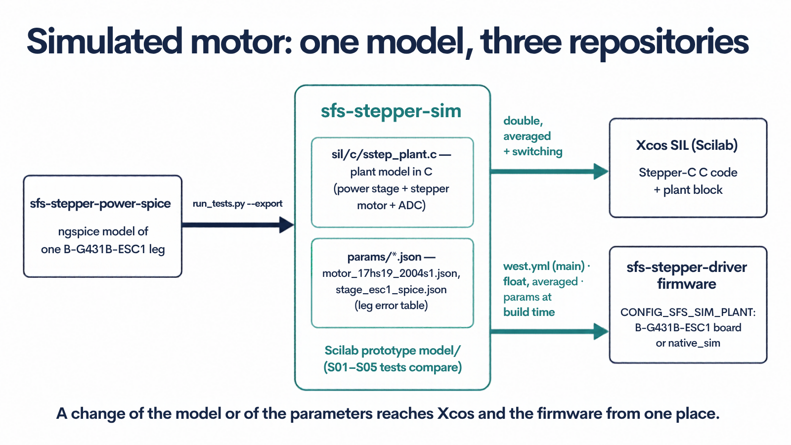
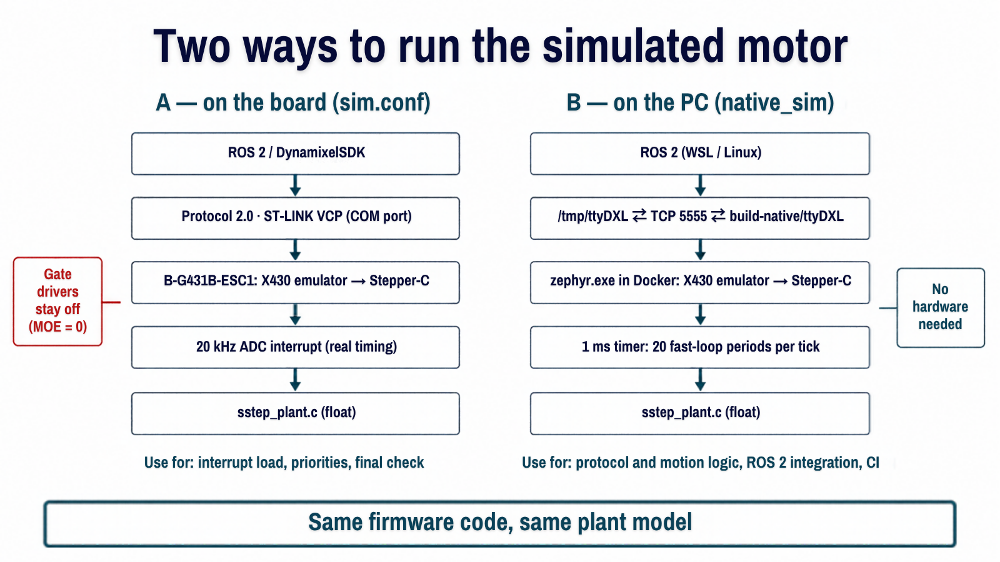

# Simulated motor

Doppelstep can run without a motor: a model of the power stage and the stepper motor
takes the place of the hardware, and everything above it (ROS 2, DYNAMIXEL Protocol 2.0,
the X430 emulator, Stepper-C) runs unchanged. The model is not a copy made for the
firmware. It is the plant model of
[Stepper-Lab](https://github.com/AntonVynohradov/Stepper-Lab), the same C code as
its Xcos block. Its parameters come from the same files the Scilab model uses, and the
power stage values come from the ngspice model of
[sfs-stepper-power-spice](https://github.com/AntonVynohradov/sfs-stepper-power-spice).



## How the pieces fit

| Repository | Role | In the firmware build |
|---|---|---|
| **sfs-stepper-power-spice** | ngspice model of one ESC1 leg. Writes the stage parameters of Stepper-Lab. | Not built. West project, next to Stepper-Lab. |
| **Stepper-Lab** | Scilab prototype, Xcos SIL, the plant model in C (`sil/c/sstep_plant.c`), parameters (`params/*.json`). | `sstep_plant.c` compiled as a Zephyr library (`float`, averaged stage). The JSON files are read at configure time. |
| **Doppelstep** | This firmware. The backend `sfs,sim-power-stage` (`drivers/power_stage/`) adapts the model to Zephyr: ADC scaling, publication. `app/src/sim_log.c` writes the log line. | Driver and application |

Both simulation repositories are west projects that follow `main` until their first
release (`west.yml`). The build glue is `modules/stepper-lab/`.

What is shared and what stays offline:

- **Shared:** the model code (`sstep_plant.c`) and its parameters (`params/*.json`).
  A change made there reaches the Xcos block and the firmware.
- **Offline:** the ngspice simulations, the switching power stage (switching instants,
  dead time, body diodes) and the Xcos diagram. They are too slow for a 50 µs control
  period. Their results enter the firmware model as parameters, most of all the
  **leg voltage error table**.

## The model

State `x = [iA, iB, ω, θe]` with `θe = p·θ` and `p = Ns / 4`:

```text
L diA/dt = vA − R iA + Kt ω sin θe
L diB/dt = vB − R iB − Kt ω cos θe
J dω/dt  = Kt (−iA sin θe + iB cos θe) − Td sin 4θe − TL − B ω − Tc tanh(ω / ωc)
dθe/dt   = p ω
```

- **Power stage:** shared leg of the B-G431B-ESC1, so `vA = vU − vW` and `vB = vV − vW`.
  Each leg gives `duty · Vbus` plus, by default, the **leg voltage error** measured with
  ngspice as a function of the leg current. The error covers the dead time, the body
  diodes and the leg resistance. In Xcos (test S05) this brings the voltage the current
  loop commands to within 19 mV of the switching stage, against 118 mV with ideal legs.
- **Timing:** one PWM period of computation delay, as on the MCU. In every period:
  `sim_plant_sample()` (ADC counts of the state) → Stepper-C fast loop →
  `sim_plant_step()` (RK4 over the period with the voltages written in the previous
  period).
- **Outputs off:** the windings are open. The currents are zero and the rotor coasts.
- **Precision:** single precision, with `θe` kept within one turn plus a turn count, so
  long runs do not lose accuracy.
- **Load:** `CONFIG_SFS_SIM_LOAD_UNM`, or `power_stage_sim_set_load()`. It is
  a constant active torque, like gravity on a joint, so it pulls the rotor back when the
  motor loses synchronism or the torque is off.

## Parameters

| Source file (Stepper-Lab) | Written by | Values |
|---|---|---|
| `params/motor_17hs19_2004s1.json` | `python tools/export_params.py`, from `params/motor_17hs19_2004s1.sci` | R, L, Kt, Ns, J, B, Td, Tc, ωc |
| `params/stage_esc1_spice.json` | sfs-stepper-power-spice `python tools/run_tests.py --export` | leg resistance, diode drop, effective dead time, leg error table and its operating point (Vbus, fs) |

At configure time the glue checks `"format": 1` and generates
`build*/zephyr/include/generated/sstep_plant_params.h`. A change of a JSON file re-runs
CMake on the next build. The file names are `CONFIG_SSTEP_PLANT_MOTOR_PARAMS` and
`CONFIG_SSTEP_PLANT_STAGE_PARAMS`.

The backend is selected by the devicetree: a `sfs,sim-power-stage` node and the `power-stage`
phandle of the motor. The firmware settings on top of the files:

| Option | Default | Meaning |
|---|---|---|
| `CONFIG_SFS_SIM_R_MOHM`, `_L_UH`, `_KT_UNM_PER_A`, `_INERTIA_G_MM2`, `_VISCOUS_UNM_S`, `_DETENT_UNM`, `_COULOMB_UNM` | −1 | Override one value of the motor file (−1 keeps the file value). Useful to test the controller against a motor that differs from the values it is tuned for. |
| `CONFIG_SFS_SIM_LEG_ERROR` | y | Use the ngspice leg error table. A warning is logged when Vbus or fs differ by more than 5 % from the operating point of the table. |
| `CONFIG_SFS_SIM_VBUS_MV` | 24000 | Supply voltage of the model |
| `CONFIG_SFS_SIM_LOAD_UNM`, `_LOCKED_ROTOR` | 0, n | Scenario |
| `CONFIG_SFS_SIM_SUBSTEPS`, `_LOG_PERIOD_MS` | 1, 1000 | RK4 steps per period, period of the log line |

The controller keeps its own values (properties of the motor node, the datasheet). The startup
log names the model file and its main values.

## Two ways to run it



| | A: on the board | B: on the PC (`native_sim`) |
|---|---|---|
| Hardware | B-G431B-ESC1, no motor needed | none |
| Timing | real: 20 kHz interrupt, UART 1 Mbps | simulated, kept to real time |
| Bus | ST-LINK VCP (COM port) | pseudoterminal, or TCP 5555 from Docker |
| Debugging | J-Link / OpenOCD, RTT | gdb on `zephyr.exe`, logs on stdout |
| Use it for | interrupt load, priorities, final check | protocol and motion logic, ROS 2 integration, CI |

### A: on the board

```bash
west build -p always -b b_g431b_esc1 -s app -d build -- -DEXTRA_DTC_OVERLAY_FILE=sim.overlay
```

Or use the VS Code task **Zephyr: Pristine Build (simulated motor)**. TIM1 and the ADCs
keep the real timing, and the samples come from the model. The simulation backend never
switches the outputs of the real stage, so the main output enable (MOE) stays off and the board runs with or without a motor and bus voltage.
The RTT log shows the commanded and rotor position, the lag in electrical degrees, the
currents, and the longest fast-loop callback in cycles and µs.

### B: on the PC

```bash
west build -b native_sim/native/64 -s app -d build-native   # task "Zephyr: Build (native_sim)"
python3 tools/sim/run_native.py run [--tcp 5555]                       # task "Zephyr: Run (native_sim)"
python3 tools/sim/dxl_smoke_test.py build-native/ttyDXL                # ping, torque, move, without ROS 2
```

`run_native.py` links the bus pseudoterminal to `build-native/ttyDXL`. In Docker (the
task on the Windows host) it also serves the bus on TCP 5555. On the ROS 2 machine,
`python3 tools/sim/run_native.py connect --host localhost --port 5555` creates
`/tmp/ttyDXL`. From Windows, `python tools\sim\dxl_smoke_test.py --tcp localhost:5555`
runs the smoke test. The pseudoterminal driver polls for the first byte of a packet
every 10 ms, so keep the host's packet timeout above that.

## Workflows

**Change a motor parameter.** Edit `params/motor_*.sci` in Stepper-Lab, then run
`python tools/export_params.py` and its tests, and push. In the Doppelstep workspace
run `west update` and rebuild. CMake regenerates `sstep_plant_params.h`.

**Change the power stage model (ngspice).** In sfs-stepper-power-spice run
`python tools/run_tests.py --export --sim <path to Stepper-Lab>`. It updates
`export/stage_esc1.json` and `params/stage_esc1_spice.*` of Stepper-Lab. In the west workspace
the two repositories are neighbours under `modules/lib`. `--export-only` rewrites those files
from the last export without ngspice. Commit
both repositories, then `west update` and rebuild.

**Change the model itself.** Edit `sil/c/sstep_plant.c` and the Scilab prototype
(`model/`) together. Run `tests/run_all.sce` in Stepper-Lab (S01–S04 compare Xcos
with the prototype sample by sample, S05 checks the leg error table). Then push, run
`west update` here and rebuild.

**Try local changes before pushing.** Point the build at a local checkout:

```bash
west build ... -- -DSTEPPER_LAB_SOURCE_DIR=/path/to/Stepper-Lab
```

With Docker, mount the checkout first, for example
`docker compose run --rm -v C:/path/to/Stepper-Lab:/sim:ro zephyr ...` with
`-DSTEPPER_LAB_SOURCE_DIR=/sim`. The value stays in the CMake cache of that build
directory until a pristine build.

## Checks

The firmware tests on `native_sim` (SIL with the model, integration with DynamixelSDK)
are described in [SIL and integration tests](testing.md).

| Where | Check |
|---|---|
| sfs-stepper-power-spice | `tools/run_tests.py`: SP01–SP03 against the datasheet; `--export` writes the contract file |
| Stepper-Lab | `tests/run_all.sce`: prototype tests and S01–S05 (Xcos SIL with `sstep_plant.c`); `tools/export_params.py --check` |
| Doppelstep | pristine builds of `b_g431b_esc1` (with and without `sim.overlay`) and `native_sim/native/64` without warnings; `tools/sim/dxl_smoke_test.py` against `run_native.py` |

## Limits

- Present Position and Present Velocity are the commanded values, as with the real
  motor, which has no encoder. The rotor position of the model appears only in the log.
- The rotor of the model is never exactly still. With the 12-bit ADC the current loop toggles by
  one count (29.4 mA, about 570 mV of phase voltage), which excites the weakly damped mechanical
  resonance, about 125 Hz at the 0.5 A hold current. It reaches about 3 rpm (0.2 microstep),
  depending on the rotor angle. Tests therefore check a stopped motor with a threshold, not with
  0 rpm. A real motor has friction and ADC noise: [measure it](hardware-checklist.md).
- The leg error table is valid at its operating point (24 V, 20 kHz, timer dead time
  500 ns, assumed board values). Re-run ngspice when these change.
- On `native_sim`, code takes no simulated time. Interrupt load and priorities are
  validated only on the board (variant A).
- `west.yml` follows `main` of both simulation repositories. Pin them to tags at their
  first release, so that every firmware build names the model it was tested with.
